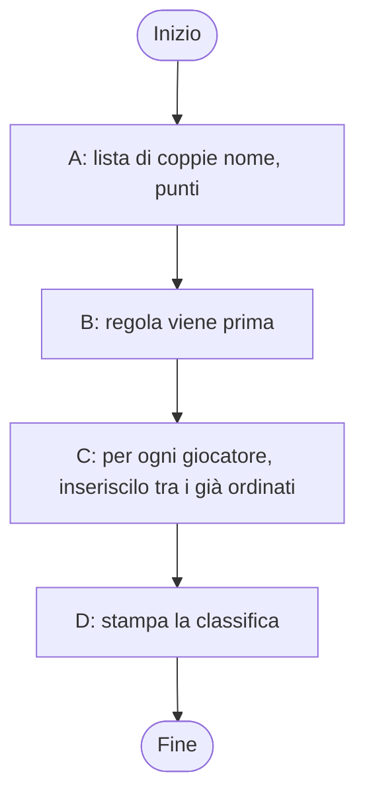
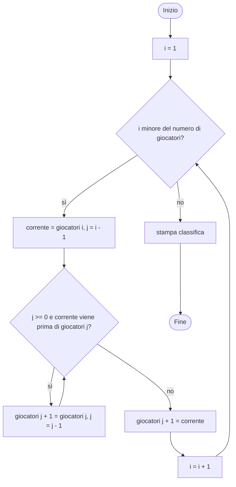
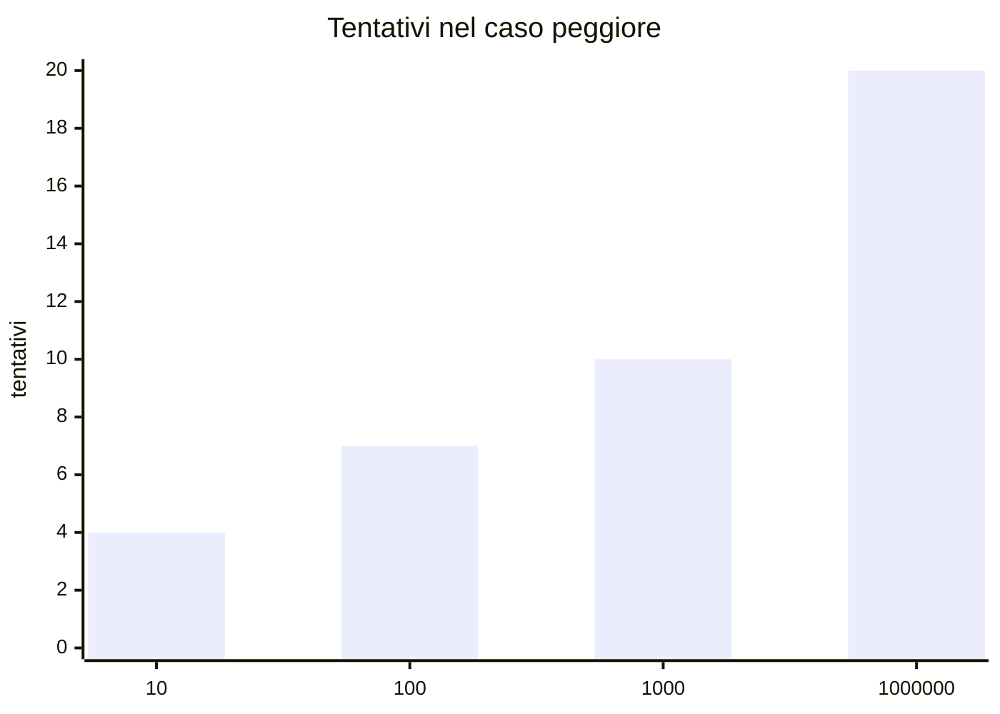
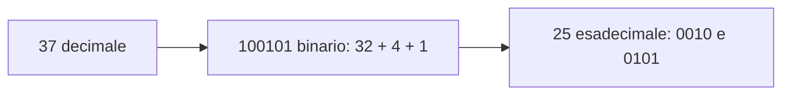

# CP2 — Pensiero computazionale

> **Parte P — Propedeutica (solo ingresso A)** · 4 lezioni (LP2.1–LP2.4) · 3 ore · formato «primario + lettura»
> **Stato:** bozza 1 (2026-10-11). Codice eseguito e verificato su PHP 8.3.6, Python 3.13.16, Rust 1.97.0 (`rustc --edition 2024`), Go 1.24.7 (baseline del corso: PHP 8.4+, Go 1.25+; da riverificare). I quattro linguaggi compaiono in lettura: l'obiettivo qui non è la sintassi, ma il **modo di ragionare** che è identico in tutti.

## Come si usa questo capitolo

Prima di scrivere codice si pensa. Questo capitolo ti allena a farlo: **scomporre** un problema, **descrivere** la soluzione con pseudocodice e diagrammi di flusso, **seguire a mano** l'esecuzione tenendo traccia dello stato, **capire come il computer rappresenta i dati**. Non serve installare nulla. Prendi carta e penna: le tabelle di tracing del capitolo si imparano compilandole.

| Lezione | Durata | Che cosa fai |
|---|---|---|
| LP2.1 — Problemi, algoritmi, scomposizione | 45′ | Trasformi un problema in passi precisi e riconosci un algoritmo |
| LP2.2 — Pseudocodice e diagrammi di flusso | 45′ | Descrivi l'algoritmo prima di codificarlo |
| LP2.3 — Stato e tracing manuale | 50′ | Segui a mano l'esecuzione e trovi un bug senza eseguire nulla |
| LP2.4 — Dati e rappresentazione | 40′ | Capisci binario, esadecimale, testo e numeri decimali approssimati |

## Obiettivi

Al termine del capitolo sai: (1) distinguere un **problema** da un **algoritmo** e scomporre il primo in attività; (2) scrivere uno **pseudocodice** e un **flowchart** con sequenza, scelta e ripetizione; (3) definire **stato** (le variabili e i loro valori in un dato istante) e compilare una **tabella di tracing**; (4) trovare un bug ragionando sul tracing; (5) spiegare perché `0.1` non è esattamente `0.1` e perché «è» in UTF-8 occupa due byte.

## Il problema reale

> Il circolo scacchistico organizza un torneo a sei giocatori. A fine giornata la segretaria ha una lista di nomi con i punti. Deve pubblicare la **classifica**: più punti prima; a parità di punti, **ordine alfabetico**. Oggi la compila a mano e sbaglia sugli spareggi. Vuole un programma che, data la lista, stampi la classifica.

Dati: Anna 3, Bruno 5, Carla 3, Dario 1, Elena 5, Franco 4.

### Scomposizione in attività

| # | Attività | In una frase |
|---|---|---|
| A | Rappresentare i dati | Ogni giocatore è una coppia (nome, punti); la lista è una sequenza di coppie |
| B | Definire «viene prima» | Regola per confrontare due giocatori: punti decrescenti, poi nome crescente |
| C | Ordinare la lista | Ripetere: prendi un giocatore e mettilo al posto giusto tra quelli già ordinati |
| D | Stampare la classifica | Numero di posizione, nome, punti |



## LP2.1 — Problemi, algoritmi, scomposizione (45′)

### Concetto 1 — Problema contro algoritmo

Un **problema** dice *che cosa* si vuole («la classifica ordinata»). Un **algoritmo** dice *come* ottenerlo: una sequenza **finita** di passi **non ambigui** che, a partire dai dati in ingresso, produce sempre il risultato. «Ordina la lista» è un problema; «prendi il secondo elemento e inseriscilo tra i precedenti nel posto giusto, poi il terzo, …» è un algoritmo. Lo stesso problema ha molti algoritmi, con costi diversi.

Tre proprietà da controllare in ogni algoritmo:

| Proprietà | Domanda di controllo | Esempio di violazione |
|---|---|---|
| Finitezza | Prima o poi si ferma? | Un ciclo la cui condizione non cambia mai |
| Non ambiguità | Ogni passo ha un solo significato? | «Metti Bruno in alto» (quanto in alto?) |
| Correttezza | Il risultato soddisfa la richiesta per ogni input? | Funziona senza spareggi, ma non con i pari punti |

### Concetto 2 — Scomporre

Scomporre significa dividere finché ogni pezzo è abbastanza piccolo da essere ovvio. Il segnale che hai scomposto bene: puoi descrivere ogni pezzo in una frase e **provarlo da solo**. Qui il pezzo B («viene prima») è il cuore del problema: se è giusto, qualsiasi algoritmo di ordinamento produce la classifica corretta. Isolarlo evita di mescolare la regola di business con il meccanismo di ordinamento.

### Concetto 3 — Il confronto come funzione

Il pezzo B si chiama **funzione** (parola che il corso riprende in C05): riceve due giocatori e risponde sì o no.

| a | b | a viene prima di b? | Perché |
|---|---|---|---|
| Bruno 5 | Anna 3 | sì | più punti |
| Anna 3 | Bruno 5 | no | meno punti |
| Anna 3 | Carla 3 | sì | pari punti, «Anna» precede «Carla» |
| Elena 5 | Bruno 5 | no | pari punti, «Elena» segue «Bruno» |

### Esercizio (5′)

Scrivi i passi per trovare il giocatore con più punti in una lista, in modo che valgano anche per una lista di mille giocatori. Verifica finitezza, non ambiguità e correttezza.

**Risposte**

> Tieni un «migliore finora» (il primo). Per ogni altro giocatore: se ha più punti del migliore, diventa il migliore. Alla fine il migliore finora è la risposta. Finisce perché la lista è finita; è corretto perché dopo ogni confronto il migliore finora è il massimo tra quelli visti. A pari punti resta il primo incontrato: va deciso, e va scritto, altrimenti il passo è ambiguo.

## LP2.2 — Pseudocodice e diagrammi di flusso (45′)

### Concetto 1 — Tre mattoni

Ogni algoritmo si costruisce con tre strutture: **sequenza** (un passo dopo l'altro), **selezione** (se… allora… altrimenti) e **iterazione** (finché… ripeti). Il resto è composizione.

### Concetto 2 — Lo pseudocodice

È un testo in lingua naturale strutturato, senza sintassi di un linguaggio. Per l'ordinamento per inserimento:

```text
per ogni posizione i da 2 fino all'ultima:
    corrente = elemento in posizione i
    j = i - 1
    finché j esiste e corrente viene prima dell'elemento j:
        sposta l'elemento j di un posto a destra
        j = j - 1
    metti corrente nel posto j + 1
```

L'idea: la parte a sinistra di `i` è già ordinata; si prende un elemento e lo si fa «scivolare» a sinistra, spostando a destra quelli che devono stargli dopo.

### Concetto 3 — Il flowchart



Nota le due frecce che tornano indietro: sono i due **cicli** (quello esterno su `i`, quello interno su `j`). Il flowchart rende visibili cose che nel testo restano nascoste, come il fatto che la condizione del ciclo interno ha **due** parti.

### Implementazione — gli stessi passi nei quattro linguaggi

Gli indici partono da 0 in tutti e quattro: la «posizione 2» dello pseudocodice è `i = 1`.

#### Python

```python
players = [("Anna", 3), ("Bruno", 5), ("Carla", 3), ("Dario", 1), ("Elena", 5), ("Franco", 4)]


def comes_before(a, b):
    """True if player a must be ranked above player b."""
    if a[1] != b[1]:
        return a[1] > b[1]  # more points first
    return a[0] < b[0]  # same points: alphabetical order


for i in range(1, len(players)):
    current = players[i]
    j = i - 1
    while j >= 0 and comes_before(current, players[j]):
        players[j + 1] = players[j]  # shift one place to the right
        j = j - 1
    players[j + 1] = current

for place, (name, points) in enumerate(players, start=1):
    print(f"{place}. {name} {points}")
```

#### PHP

```php
<?php
$players = [["Anna", 3], ["Bruno", 5], ["Carla", 3], ["Dario", 1], ["Elena", 5], ["Franco", 4]];

// true if player $a must be ranked above player $b
function comesBefore(array $a, array $b): bool
{
    if ($a[1] !== $b[1]) {
        return $a[1] > $b[1]; // more points first
    }
    return strcmp($a[0], $b[0]) < 0; // same points: alphabetical order
}

for ($i = 1; $i < count($players); $i++) {
    $current = $players[$i];
    $j = $i - 1;
    while ($j >= 0 && comesBefore($current, $players[$j])) {
        $players[$j + 1] = $players[$j]; // shift one place to the right
        $j = $j - 1;
    }
    $players[$j + 1] = $current;
}

foreach ($players as $index => [$name, $points]) {
    echo ($index + 1) . ". $name $points\n";
}
```

#### Rust

```rust
// true if player a must be ranked above player b
fn comes_before(a: (&str, u32), b: (&str, u32)) -> bool {
    if a.1 != b.1 {
        return a.1 > b.1; // more points first
    }
    a.0 < b.0 // same points: alphabetical order
}

fn main() {
    let mut players = vec![("Anna", 3), ("Bruno", 5), ("Carla", 3), ("Dario", 1), ("Elena", 5), ("Franco", 4)];

    for i in 1..players.len() {
        let current = players[i];
        let mut j = i as i32 - 1;
        while j >= 0 && comes_before(current, players[j as usize]) {
            players[(j + 1) as usize] = players[j as usize]; // shift one place to the right
            j -= 1;
        }
        players[(j + 1) as usize] = current;
    }

    for (index, (name, points)) in players.iter().enumerate() {
        println!("{}. {} {}", index + 1, name, points);
    }
}
```

#### Go

```go
package main

import "fmt"

type Player struct {
	Name   string
	Points int
}

// comesBefore is true if player a must be ranked above player b.
func comesBefore(a, b Player) bool {
	if a.Points != b.Points {
		return a.Points > b.Points // more points first
	}
	return a.Name < b.Name // same points: alphabetical order
}

func main() {
	players := []Player{{"Anna", 3}, {"Bruno", 5}, {"Carla", 3}, {"Dario", 1}, {"Elena", 5}, {"Franco", 4}}

	for i := 1; i < len(players); i++ {
		current := players[i]
		j := i - 1
		for j >= 0 && comesBefore(current, players[j]) {
			players[j+1] = players[j] // shift one place to the right
			j = j - 1
		}
		players[j+1] = current
	}

	for index, p := range players {
		fmt.Printf("%d. %s %d\n", index+1, p.Name, p.Points)
	}
}
```

Output identico nei quattro linguaggi:

```text
1. Bruno 5
2. Elena 5
3. Franco 4
4. Anna 3
5. Carla 3
6. Dario 1
```

### Focus comparativo

| Aspetto | Python | PHP | Rust | Go |
|---|---|---|---|---|
| Ciclo con contatore | `for i in range(1, n)` | `for ($i = 1; ...)` | `for i in 1..n` | `for i := 1; ...` |
| Ciclo con condizione | `while` | `while` | `while` | `for cond {}` (Go ha solo `for`) |
| Coppia nome/punti | tupla | array di 2 elementi | tupla | `struct` con campi nominati |
| Indice che può scendere sotto zero | intero normale | intero normale | `i32` (con `usize` sarebbe un errore) | `int` |
| Confronto tra stringhe | `a < b` | `strcmp` | `a < b` | `a < b` |

Lo scheletro è lo stesso: l'algoritmo non dipende dal linguaggio. Cambia come lo si dice.

### Esercizio (5′)

Disegna il flowchart per «indovina il numero»: il computer sceglie un numero tra 1 e 100, tu proponi un valore, ti dice «troppo alto», «troppo basso» o «trovato».

**Risposte**

> Un ciclo con una condizione di uscita: leggi proposta → se uguale esci con «trovato»; se maggiore stampa «troppo alto»; altrimenti «troppo basso»; poi torna a leggere. È l'unico flowchart con una freccia di ritorno e una sola uscita.

## LP2.3 — Stato e tracing manuale (50′)

### Concetto 1 — Che cos'è lo stato

Lo **stato** è la fotografia di tutte le variabili e dei loro valori in un istante. Un programma è una successione di stati: ogni istruzione ne produce uno nuovo. **Fare il tracing** vuol dire compilare a mano una tabella con lo stato dopo ogni passo. È il modo più economico di capire (e correggere) un programma: non serve eseguirlo.

### Concetto 2 — Tracing dell'ordinamento

Stato della lista alla fine di ogni iterazione del ciclo esterno (la parte a sinistra di `i` è ordinata):

| Dopo i = | Lista | Che cosa è successo |
|---|---|---|
| (inizio) | Anna 3, Bruno 5, Carla 3, Dario 1, Elena 5, Franco 4 | |
| 1 | Bruno 5, Anna 3, Carla 3, Dario 1, Elena 5, Franco 4 | Bruno ha più punti di Anna: scambio |
| 2 | Bruno 5, Anna 3, Carla 3, Dario 1, Elena 5, Franco 4 | Carla 3 non batte Anna 3 (alfabetico): resta |
| 3 | Bruno 5, Anna 3, Carla 3, Dario 1, Elena 5, Franco 4 | Dario 1 è già ultimo |
| 4 | Bruno 5, Elena 5, Anna 3, Carla 3, Dario 1, Franco 4 | Elena batte tutti tranne Bruno (alfabetico) |
| 5 | Bruno 5, Elena 5, Franco 4, Anna 3, Carla 3, Dario 1 | Franco 4 va dopo i due da 5 |

Contando i confronti «viene prima» eseguiti si ottiene 11.

### Concetto 3 — Un bug da trovare a mano

Sostituiamo nella condizione `j >= 0` con `j > 0`: una modifica di un carattere. Il programma gira, non dà errori, stampa una classifica **sbagliata**:

```text
1. Anna 3
2. Bruno 5
3. Elena 5
4. Franco 4
5. Carla 3
6. Dario 1
```

Tracing del primo passo con la modifica: `i = 1`, `corrente = Bruno 5`, `j = 0`. La condizione `j > 0` è falsa, il ciclo interno non parte, Bruno resta dov'è: **il confronto con il primo elemento non avviene mai**. Anna 3 resta prima di Bruno 5 e di Elena 5.

La lezione generale: un bug di tipo **off-by-one** (fuori di uno) si trova guardando i *casi limite* del tracing, cioè il primo e l'ultimo passo di ogni ciclo. Il programma non segnala nulla: è corretto sintatticamente, sbagliato semanticamente.

### Strumenti per il tracing

| Tecnica | Quando | Costo |
|---|---|---|
| Tabella a mano | Algoritmi piccoli, esercizi | Carta e penna |
| Stampa intermedia (`print`, `echo`, `println!`, `fmt.Println`) | Verifica rapida di un valore | Poche righe da togliere |
| Debugger passo-passo | Programmi grandi (CP3) | Serve conoscere lo strumento |

### Esercizio (10′)

Esegui il tracing della ricerca binaria (codice qui sotto) per `secret = 37` nell'intervallo 1..100. Compila una tabella con `low`, `high`, `middle`, esito.

```python
def attempts(secret, low=1, high=100):
    """How many guesses are needed to find `secret` between low and high."""
    count = 0
    while low <= high:
        middle = (low + high) // 2
        count = count + 1
        if middle == secret:
            return count
        if secret < middle:
            high = middle - 1
        else:
            low = middle + 1
    return -1  # secret is outside the range


for secret in [1, 37, 50, 100]:
    print(f"secret={secret} attempts={attempts(secret)}")
```

**Risposte**

> | Passo | low | high | middle | Esito |
> |---|---|---|---|---|
> | 1 | 1 | 100 | 50 | secret minore di middle → high = 49 |
> | 2 | 1 | 49 | 25 | secret maggiore di middle → low = 26 |
> | 3 | 26 | 49 | 37 | trovato |
>
> Servono 3 tentativi. L'output del programma per 1, 37, 50, 100 è:

```text
secret=1 attempts=6
secret=37 attempts=3
secret=50 attempts=1
secret=100 attempts=7
```

Il secondo algoritmo introduce un'idea importante: ogni tentativo **dimezza** l'intervallo, quindi per 1..100 bastano al massimo 7 tentativi (con 1000 numeri, 10). Scorrere la lista da 1 a 100 ne avrebbe richiesti fino a 100. Gli algoritmi si confrontano così: quante operazioni servono al crescere dei dati.



(Per un milione di elementi la ricerca lineare ne richiederebbe fino a un milione; la binaria, venti.) La ricerca binaria funziona **solo** se i dati sono già ordinati: ecco perché l'ordinamento è il primo problema che si studia.

## LP2.4 — Dati e rappresentazione (40′)

### Concetto 1 — Tutto è numero, e tutto è binario

Il computer memorizza tutto come sequenze di **bit** (0 o 1). Un gruppo di 8 bit è un **byte**. Scrivere un numero in **binario** significa usare solo le cifre 0 e 1 con pesi 1, 2, 4, 8, … Il 37 è `100101` perché 32 + 4 + 1. L'**esadecimale** (base 16, cifre 0–9 e a–f) è una scrittura compatta: ogni cifra esadecimale vale 4 bit, quindi 37 = `0010 0101` = `25`.



### Concetto 2 — Il testo

Un carattere è identificato da un numero (**code point**, standard Unicode). Un code point viene poi scritto in byte con una **codifica**; la più diffusa è **UTF-8**, che usa 1 byte per i caratteri ASCII e da 2 a 4 per gli altri. Per questo la stringa `Aè` ha 2 caratteri e **3 byte**: `A` = 65 (1 byte), `è` = 232 (2 byte: 195 e 168). Conoscere la differenza tra *lunghezza in caratteri* e *lunghezza in byte* evita bug seri con i nomi accentati (C07 lo riprende).

### Concetto 3 — I numeri con la virgola

I numeri decimali sono memorizzati in **binario in virgola mobile**. Alcune frazioni decimali semplici, come 0,1, non hanno rappresentazione binaria finita (come 1/3 non ce l'ha in decimale). Il computer ne memorizza la più vicina:

```text
37 in binary : 100101
37 in hex    : 25
binary 100101: 37
code points  : [65, 232]
UTF-8 bytes  : [65, 195, 168]
0.1 exactly  : 0.10000000000000000555
True as int  : 1 | 1 < 2 is True
```

`0.1` è in realtà `0.1000000000000000055…`. Conseguenza pratica: **non confrontare con `==` i risultati di calcoli decimali**, e per i **soldi** usare interi (centesimi), come nel programma dello scontrino di C02.

### Implementazione — lo stesso programma nei quattro linguaggi

#### Python

```python
n = 37
print(f"37 in binary : {n:b}")
print(f"37 in hex    : {n:x}")
print(f"binary 100101: {int('100101', 2)}")

text = "Aè"
print("code points  :", [ord(c) for c in text])
print("UTF-8 bytes  :", list(text.encode("utf-8")))

print(f"0.1 exactly  : {0.1:.20f}")
print("True as int  :", int(True), "| 1 < 2 is", 1 < 2)
```

#### PHP

```php
<?php
$n = 37;
echo "37 in binary : ", decbin($n), "\n";
echo "37 in hex    : ", dechex($n), "\n";
echo "binary 100101: ", bindec('100101'), "\n";

$text = "Aè";
echo "code points  : [", implode(", ", array_map('mb_ord', mb_str_split($text))), "]\n";
echo "UTF-8 bytes  : [", implode(", ", array_map('ord', str_split($text))), "]\n";

printf("0.1 exactly  : %.20f\n", 0.1);
echo "True as int  : ", (int) true, " | 1 < 2 is ", var_export(1 < 2, true), "\n";
```

#### Rust

```rust
fn main() {
    let n = 37;
    println!("37 in binary : {:b}", n);
    println!("37 in hex    : {:x}", n);
    println!("binary 100101: {}", i32::from_str_radix("100101", 2).unwrap());

    let text = "Aè";
    let code_points: Vec<u32> = text.chars().map(|c| c as u32).collect();
    println!("code points  : {:?}", code_points);
    println!("UTF-8 bytes  : {:?}", text.as_bytes());

    println!("0.1 exactly  : {:.20}", 0.1_f64);
    println!("True as int  : {} | 1 < 2 is {}", true as i32, 1 < 2);
}
```

#### Go

```go
package main

import (
	"fmt"
	"strconv"
)

func main() {
	n := 37
	fmt.Printf("37 in binary : %b\n", n)
	fmt.Printf("37 in hex    : %x\n", n)
	v, _ := strconv.ParseInt("100101", 2, 64)
	fmt.Println("binary 100101:", v)

	text := "Aè"
	var codePoints []rune
	for _, r := range text {
		codePoints = append(codePoints, r)
	}
	fmt.Println("code points  :", codePoints)
	fmt.Println("UTF-8 bytes  :", []byte(text))

	fmt.Printf("0.1 exactly  : %.20f\n", 0.1)
	fmt.Println("1 < 2 is", 1 < 2) // Go has no automatic bool/int conversion
}
```

Gli output coincidono salvo la forma: Go stampa le liste senza virgole (`[65 232]`) e non ha la conversione automatica da booleano a intero, quindi quella riga non c'è.

### Focus comparativo

| Aspetto | Python | PHP | Rust | Go |
|---|---|---|---|---|
| Binario/esadecimale | `format(n, "b")` / `"x"` | `decbin` / `dechex` | `{:b}` / `{:x}` | `%b` / `%x` |
| Code point | `ord` | `mb_ord` | `c as u32` | `rune` |
| Byte UTF-8 | `.encode("utf-8")` | `str_split` + `ord` | `.as_bytes()` | `[]byte(s)` |
| Booleano come intero | `int(True)` | `(int) true` | `true as i32` | non consentito |

### Esercizio (10′)

(1) Scrivi 13 in binario. (2) Quanti byte occupa `€` in UTF-8, sapendo che il suo code point è 8364? (3) Perché `0.1 + 0.2 == 0.3` è falso nella maggior parte dei linguaggi?

**Risposte**

> (1) 13 = 8 + 4 + 1 → `1101`. (2) 8364 > 2047 e < 65535: servono 3 byte (`e2 82 ac`). (3) Né 0.1, né 0.2, né 0.3 sono rappresentabili esattamente; la somma delle due approssimazioni non coincide con l'approssimazione di 0.3.

## Riepilogo

| Concetto | Idea chiave | Dove si riprende |
|---|---|---|
| Algoritmo | Passi finiti, non ambigui, corretti | C05 funzioni |
| Scomposizione | Isolare la regola dal meccanismo | Tutti i progetti |
| Selezione e iterazione | Le due strutture di controllo | C03 |
| Stato e tracing | Variabili + valori a ogni passo | CP3 debugging |
| Off-by-one | Si trova nei casi limite | C03, C04 |
| Rappresentazione | Binario, UTF-8, virgola mobile | C02, C07 |

Collegamenti: CP1 (cos'è un programma), CP3 (strumenti di debug), C02 (tipi e valori).

## Ponte

CP3 trasforma il tracing a mano in strumenti: terminale, messaggi d'errore e stack trace, debugger e Git per tornare a una versione funzionante.

---

## Appendice CP2.A — I programmi

Esecuzione dopo l'installazione (C01) o in un playground. Gli esempi usano solo la libreria standard.

#### Python (ranking.py) — `python3 ranking.py`

```python
players = [("Anna", 3), ("Bruno", 5), ("Carla", 3), ("Dario", 1), ("Elena", 5), ("Franco", 4)]


def comes_before(a, b):
    """True if player a must be ranked above player b."""
    if a[1] != b[1]:
        return a[1] > b[1]  # more points first
    return a[0] < b[0]  # same points: alphabetical order


for i in range(1, len(players)):
    current = players[i]
    j = i - 1
    while j >= 0 and comes_before(current, players[j]):
        players[j + 1] = players[j]  # shift one place to the right
        j = j - 1
    players[j + 1] = current

for place, (name, points) in enumerate(players, start=1):
    print(f"{place}. {name} {points}")
```

#### PHP (ranking.php) — `php ranking.php`

```php
<?php
$players = [["Anna", 3], ["Bruno", 5], ["Carla", 3], ["Dario", 1], ["Elena", 5], ["Franco", 4]];

// true if player $a must be ranked above player $b
function comesBefore(array $a, array $b): bool
{
    if ($a[1] !== $b[1]) {
        return $a[1] > $b[1]; // more points first
    }
    return strcmp($a[0], $b[0]) < 0; // same points: alphabetical order
}

for ($i = 1; $i < count($players); $i++) {
    $current = $players[$i];
    $j = $i - 1;
    while ($j >= 0 && comesBefore($current, $players[$j])) {
        $players[$j + 1] = $players[$j]; // shift one place to the right
        $j = $j - 1;
    }
    $players[$j + 1] = $current;
}

foreach ($players as $index => [$name, $points]) {
    echo ($index + 1) . ". $name $points\n";
}
```

#### Rust (ranking.rs) — `rustc --edition 2024 ranking.rs && ./ranking`

```rust
// true if player a must be ranked above player b
fn comes_before(a: (&str, u32), b: (&str, u32)) -> bool {
    if a.1 != b.1 {
        return a.1 > b.1; // more points first
    }
    a.0 < b.0 // same points: alphabetical order
}

fn main() {
    let mut players = vec![("Anna", 3), ("Bruno", 5), ("Carla", 3), ("Dario", 1), ("Elena", 5), ("Franco", 4)];

    for i in 1..players.len() {
        let current = players[i];
        let mut j = i as i32 - 1;
        while j >= 0 && comes_before(current, players[j as usize]) {
            players[(j + 1) as usize] = players[j as usize]; // shift one place to the right
            j -= 1;
        }
        players[(j + 1) as usize] = current;
    }

    for (index, (name, points)) in players.iter().enumerate() {
        println!("{}. {} {}", index + 1, name, points);
    }
}
```

#### Go (main.go, go.mod con `module example.com/ranking`) — `go run .`

```go
package main

import "fmt"

type Player struct {
	Name   string
	Points int
}

// comesBefore is true if player a must be ranked above player b.
func comesBefore(a, b Player) bool {
	if a.Points != b.Points {
		return a.Points > b.Points // more points first
	}
	return a.Name < b.Name // same points: alphabetical order
}

func main() {
	players := []Player{{"Anna", 3}, {"Bruno", 5}, {"Carla", 3}, {"Dario", 1}, {"Elena", 5}, {"Franco", 4}}

	for i := 1; i < len(players); i++ {
		current := players[i]
		j := i - 1
		for j >= 0 && comesBefore(current, players[j]) {
			players[j+1] = players[j] // shift one place to the right
			j = j - 1
		}
		players[j+1] = current
	}

	for index, p := range players {
		fmt.Printf("%d. %s %d\n", index+1, p.Name, p.Points)
	}
}
```

#### Python (ranking_bug.py) — `python3 ranking_bug.py`

```python
players = [("Anna", 3), ("Bruno", 5), ("Carla", 3), ("Dario", 1), ("Elena", 5), ("Franco", 4)]


def comes_before(a, b):
    """True if player a must be ranked above player b."""
    if a[1] != b[1]:
        return a[1] > b[1]  # more points first
    return a[0] < b[0]  # same points: alphabetical order


for i in range(1, len(players)):
    current = players[i]
    j = i - 1
    while j > 0 and comes_before(current, players[j]):
        players[j + 1] = players[j]  # shift one place to the right
        j = j - 1
    players[j + 1] = current

for place, (name, points) in enumerate(players, start=1):
    print(f"{place}. {name} {points}")
```
