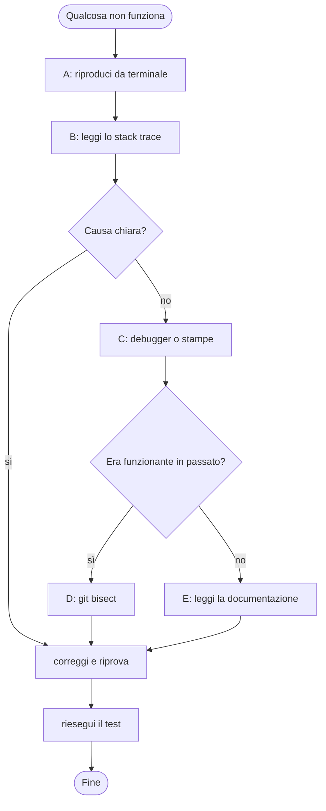
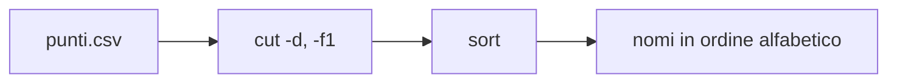
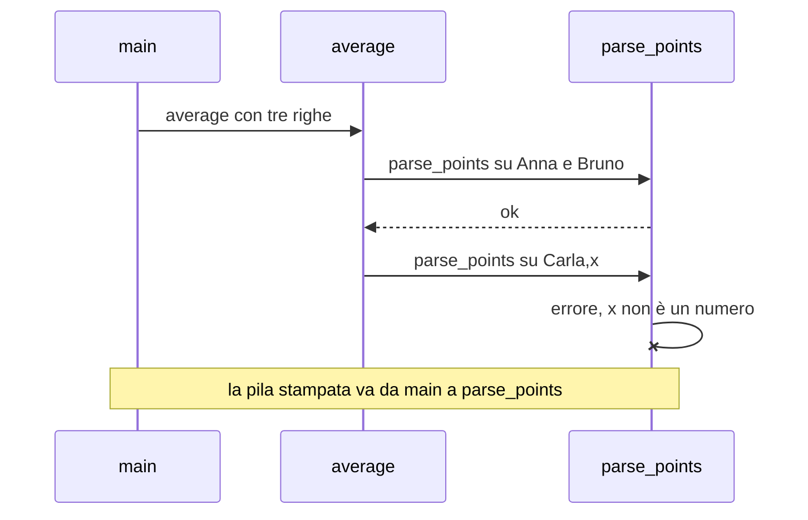
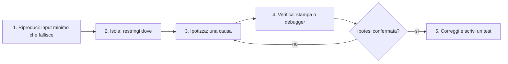
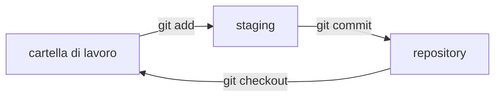
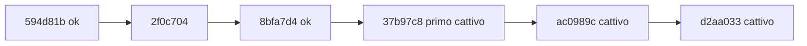

# CP3 — Terminale, errori, debugging e Git

> **Parte P — Propedeutica (solo ingresso A)** · 5 lezioni (LP3.1–LP3.5) · 3,5 ore · formato «primario + lettura»
> **Stato:** bozza 1 (2026-10-11). Output reali ottenuti su Linux con PHP 8.3.6, Python 3.13.16, Rust 1.97.0 (`rustc --edition 2024`), Go 1.24.7 e Git 2.43.0 (baseline del corso: PHP 8.4+, Go 1.25+; da riverificare). I percorsi nelle tracce sono quelli della macchina di prova: sul tuo computer saranno diversi. Il debugger mostrato è `pdb` di Python; per Rust, Go e PHP si indica lo strumento equivalente senza una sessione dimostrativa (`gdb`/`lldb` sono presenti ma non usati qui, Delve e Xdebug non sono stati installati).

## Come si usa questo capitolo

Dopo CP2 sai ragionare su un programma. Ora ti servono gli **strumenti del mestiere**: il terminale per lanciare comandi, la capacità di **leggere un messaggio d'errore** invece di spaventarti, un metodo per **trovare i bug**, **Git** per non perdere il lavoro e tornare indietro, e l'abitudine di **leggere la documentazione**. Puoi seguire il capitolo anche senza installare nulla: i comandi sono riportati con il loro output reale.

| Lezione | Durata | Che cosa fai |
|---|---|---|
| LP3.1 — Il terminale | 40′ | Usi comandi base, pipe, codici di uscita |
| LP3.2 — Leggere errori e stack trace | 45′ | Trovi dove e perché un programma si ferma, in 4 linguaggi |
| LP3.3 — Debugging: metodo e strumenti | 50′ | Applichi un metodo e usi un debugger passo-passo |
| LP3.4 — Git essenziale e `git bisect` | 50′ | Salvi versioni e trovi il commit che ha rotto il codice |
| LP3.5 — Leggere la documentazione | 25′ | Sai dove e come cercare una risposta ufficiale |

## Obiettivi

Al termine del capitolo sai: (1) spostarti tra cartelle, leggere file e concatenare comandi nel terminale; (2) leggere uno **stack trace** dall'ultima riga verso l'alto in Python, PHP, Rust e Go; (3) seguire il metodo **riproduci → isola → ipotizza → verifica → correggi** e usare un debugger; (4) usare `git init`, `add`, `commit`, `log`, `diff` e `bisect`; (5) trovare nella documentazione ufficiale la firma e un esempio di una funzione.

## Il problema reale

> Il circolo scacchistico ha un file `punti.csv` con una riga per giocatore («nome,punti»). Un programma calcola la media punti, ma da stamattina si ferma con un errore incomprensibile. Inoltre qualcuno ha modificato la regola delle quote senior e nessuno sa quando. Serve: (1) capire dove e perché si ferma il programma; (2) trovare la versione in cui la regola è stata rotta; (3) poterlo fare di nuovo senza panico.

### Scomposizione in attività

| # | Attività | Strumento |
|---|---|---|
| A | Guardare i file e lanciare il programma | Terminale |
| B | Leggere l'errore e individuare la riga | Stack trace |
| C | Osservare le variabili mentre il programma gira | Debugger |
| D | Trovare il commit che ha introdotto il bug | Git |
| E | Controllare nella documentazione il comportamento corretto | Documentazione ufficiale |



## LP3.1 — Il terminale (40′)

### Concetto 1 — Che cos'è

Il **terminale** è una finestra in cui si scrivono comandi testuali; la **shell** (ad esempio Bash o PowerShell) li interpreta. Ogni comando ha un nome, delle **opzioni** (precedute da `-`) e degli **argomenti**. Il vantaggio: i comandi si ripetono, si salvano e si automatizzano; gli editor e i servizi li usano allo stesso modo.

### Concetto 2 — I comandi minimi

| Comando | Che cosa fa |
|---|---|
| `pwd` | Mostra la cartella corrente |
| `ls` | Elenca i file (`ls -la` mostra anche i nascosti e i dettagli) |
| `cd nome` / `cd ..` | Entra in una cartella / torna indietro |
| `mkdir nome` | Crea una cartella |
| `cat file` | Mostra il contenuto di un file |
| `grep testo file` | Cerca righe che contengono il testo |
| `sort`, `cut`, `wc` | Ordina, estrae colonne, conta |
| `>` | Scrive l'output in un file |
| `\|` | Passa l'output al comando successivo (**pipe**) |

Su Windows, PowerShell ha comandi simili (`Get-ChildItem`, `Get-Content`, `Select-String`); il corso usa Bash perché è la shell di Linux, macOS e WSL.

### Implementazione — una sessione reale

Il file `punti.csv` viene creato, letto e analizzato. Ogni riga che inizia per `$` è un comando, il resto è l'output.

```text
$ pwd
/home/foo/torneo
$ printf 'Anna,3\nBruno,5\nCarla,3\n' > punti.csv
$ cat punti.csv
Anna,3
Bruno,5
Carla,3
$ grep -c ',3' punti.csv
2
$ sort -t, -k2 -nr punti.csv
Bruno,5
Carla,3
Anna,3
$ cut -d, -f1 punti.csv | sort
Anna
Bruno
Carla
$ ls
punti.csv
$ wc -l < punti.csv
3
$ ls nonesiste; echo "exit=$?"
ls: cannot access 'nonesiste': No such file or directory
exit=2
```

Cose da notare:

- `grep -c` **conta** le righe trovate (2 giocatori con 3 punti).
- `sort -t, -k2 -nr` ordina per la **seconda colonna** (`-k2`), come numero (`-n`), in ordine inverso (`-r`). Attenzione: `-r` inverte anche lo spareggio, quindi Carla precede Anna: la classifica con spareggio alfabetico di CP2 non si ottiene con questo comando. Un comando fa quello che dici, non quello che intendi.
- L'ultimo comando fallisce: `ls` stampa un messaggio e restituisce **codice di uscita** 2. Per convenzione `0` significa successo, qualsiasi altro valore un errore. È la prima cosa che gli script e Git controllano.



### Focus comparativo: il terminale nei quattro linguaggi

| Compito | Python | PHP | Rust | Go |
|---|---|---|---|---|
| Eseguire un file | `python3 f.py` | `php f.php` | `rustc f.rs && ./f` oppure `cargo run` | `go run .` |
| Argomenti da riga di comando | `sys.argv` | `$argv` | `std::env::args()` | `os.Args` |
| Codice di uscita | `sys.exit(2)` | `exit(2)` | `std::process::exit(2)` | `os.Exit(2)` |

### Esercizio (5′)

Scrivi il comando che mostra i nomi dei giocatori con 5 punti, ordinati alfabeticamente.

**Risposte**

> `grep ',5$' punti.csv | cut -d, -f1 | sort` — il `$` nell'espressione significa «fine riga», così non si trova «5» dentro altri numeri come «15».

## LP3.2 — Leggere errori e stack trace (45′)

### Concetto 1 — Un errore è un'informazione

Un messaggio d'errore dice **che cosa** è successo (il tipo), **perché** (il dettaglio) e **dove** (le righe di codice). Chi comincia tende a leggere solo l'inizio e ad arrendersi. Il metodo è l'opposto: si legge la **riga finale** (il tipo e il dettaglio) e poi si risale verso l'alto per i luoghi.

### Concetto 2 — Lo stack trace

Quando una funzione chiama un'altra, il programma tiene una **pila di chiamate** (*call stack*): `main` chiama `average`, `average` chiama `parse_points`. Se `parse_points` fallisce, lo **stack trace** (o *traceback*) elenca la pila: chi ha chiamato chi, fino al punto del guasto. Si legge così:

| Dove | Che cosa trovi |
|---|---|
| Riga del tipo di errore | Che cosa è andato storto |
| Prima voce della pila (la più «profonda») | La riga dove è esploso |
| Voci successive | Chi ha chiamato la funzione, fino a `main` |



### Implementazione — lo stesso errore in quattro linguaggi

Il programma calcola la media dei punti, ma la terza riga contiene `x` al posto di un numero. Il programma è lo stesso, scritto nei quattro linguaggi.

#### Python

```python
def parse_points(line):
    name, points = line.split(",")
    return name, int(points)


def average(lines):
    total = 0
    for line in lines:
        name, points = parse_points(line)
        total = total + points
    return total / len(lines)


print(average(["Anna,3", "Bruno,5", "Carla,x"]))
```

Output reale:

```text
Traceback (most recent call last):
  File "/home/claude/cp3/py/avg.py", line 14, in <module>
    print(average(["Anna,3", "Bruno,5", "Carla,x"]))
          ~~~~~~~^^^^^^^^^^^^^^^^^^^^^^^^^^^^^^^^^^
  File "/home/claude/cp3/py/avg.py", line 9, in average
    name, points = parse_points(line)
                   ~~~~~~~~~~~~^^^^^^
  File "/home/claude/cp3/py/avg.py", line 3, in parse_points
    return name, int(points)
                 ~~~^^^^^^^^
ValueError: invalid literal for int() with base 10: 'x'
```

Python mette la voce più recente **in fondo**: l'ultima riga è l'errore, subito sopra c'è la riga che lo ha causato (`int(points)`, riga 3).

#### PHP

```php
<?php
function parsePoints(string $line): array
{
    [$name, $points] = explode(",", $line);
    if (!ctype_digit($points)) {
        throw new InvalidArgumentException("invalid points: $points");
    }
    return [$name, (int) $points];
}

function average(array $lines): float
{
    $total = 0;
    foreach ($lines as $line) {
        [$name, $points] = parsePoints($line);
        $total += $points;
    }
    return $total / count($lines);
}

echo average(["Anna,3", "Bruno,5", "Carla,x"]), "\n";
```

```text
PHP Fatal error:  Uncaught InvalidArgumentException: invalid points: x in /home/claude/cp3/php/avg.php:6
Stack trace:
#0 /home/claude/cp3/php/avg.php(15): parsePoints()
#1 /home/claude/cp3/php/avg.php(21): average()
#2 {main}
  thrown in /home/claude/cp3/php/avg.php on line 6
```

In PHP lanciamo noi un'eccezione (`throw`) con un messaggio chiaro. La traccia numera le chiamate dalla più interna (`#0`) alla più esterna (`{main}`). I parametri non compaiono (`parsePoints()`): è il comportamento della configurazione di questa macchina e può variare.

#### Rust

```rust
fn parse_points(line: &str) -> (String, i32) {
    let (name, points) = line.split_once(',').unwrap();
    (name.to_string(), points.parse::<i32>().unwrap())
}

fn average(lines: &[&str]) -> f64 {
    let mut total = 0;
    for line in lines {
        let (_name, points) = parse_points(line);
        total += points;
    }
    total as f64 / lines.len() as f64
}

fn main() {
    println!("{}", average(&["Anna,3", "Bruno,5", "Carla,x"]));
}
```

```text

thread 'main' (10945) panicked at rs/avg.rs:3:46:
called `Result::unwrap()` on an `Err` value: ParseIntError { kind: InvalidDigit }
stack backtrace:
   0: __rustc::rust_begin_unwind
             at /rustc/2d8144b7880597b6e6d3dfd63a9a9efae3f533d3/library/std/src/panicking.rs:689:5
   1: core::panicking::panic_fmt
             at /rustc/2d8144b7880597b6e6d3dfd63a9a9efae3f533d3/library/core/src/panicking.rs:80:14
   2: core::result::unwrap_failed
             at /rustc/2d8144b7880597b6e6d3dfd63a9a9efae3f533d3/library/core/src/result.rs:1867:5
   3: avg::parse_points
   4: avg::average
   5: avg::main
   6: <fn() as core::ops::function::FnOnce<()>>::call_once
note: Some details are omitted, run with `RUST_BACKTRACE=full` for a verbose backtrace.
```

Rust ha fermato il thread con un **panic** perché `unwrap()` ha trovato un `Err`. Il messaggio dice il file e la colonna (`rs/avg.rs:3:46`). Per vedere la pila serve la variabile d'ambiente `RUST_BACKTRACE=1`; le voci `3`, `4`, `5` sono le nostre funzioni (`parse_points`, `average`, `main`), le altre sono interne alla libreria standard. In questa compilazione senza `-g` le righe delle nostre funzioni non sono indicate.

#### Go

```go
package main

import (
	"fmt"
	"strconv"
	"strings"
)

func parsePoints(line string) (string, int) {
	parts := strings.Split(line, ",")
	points, err := strconv.Atoi(parts[1])
	if err != nil {
		panic(err)
	}
	return parts[0], points
}

func average(lines []string) float64 {
	total := 0
	for _, line := range lines {
		_, points := parsePoints(line)
		total += points
	}
	return float64(total) / float64(len(lines))
}

func main() {
	fmt.Println(average([]string{"Anna,3", "Bruno,5", "Carla,x"}))
}
```

```text
panic: strconv.Atoi: parsing "x": invalid syntax

goroutine 1 [running]:
main.parsePoints({0x4b7102?, 0x7f7a9e566710?})
	/home/claude/cp3/go/main.go:13 +0x72
main.average({0xc00009cf00?, 0x3, 0xc00009cf40?})
	/home/claude/cp3/go/main.go:21 +0x3d
main.main()
	/home/claude/cp3/go/main.go:28 +0x75
exit status 2
```

Go stampa `panic:` con il messaggio, poi `goroutine 1 [running]` e le funzioni con **file e riga**: `main.go:13` è il `panic(err)`. Go non ha eccezioni: una funzione restituisce l'errore e il chiamante lo gestisce; qui lo abbiamo trasformato volutamente in un `panic` per mostrare la traccia. Il capitolo C09 spiega il modo corretto.

### Focus comparativo

| Aspetto | Python | PHP | Rust | Go |
|---|---|---|---|---|
| Come si chiama | Traceback | Stack trace | Backtrace | Goroutine trace |
| Ordine della pila | Dal più esterno al più interno (errore in fondo) | Dal più interno (`#0`) | Dal più interno (0) | Dal più interno |
| Errore a causa di | Eccezione (`ValueError`) | Eccezione (`throw`) | `unwrap()` su `Err` (panic) | `panic(err)` |
| Numeri di riga | Sì | Sì | Sì, solo il punto del panic | Sì |
| Come ottenere la pila | Automatica | Automatica | `RUST_BACKTRACE=1` | Automatica |
| Codice di uscita | 1 | 255 | 101 | 2 (con `go run` il comando stampa `exit status 2` e restituisce 1) |

Il lavoro mentale è identico: ultima riga per il *perché*, voci della pila per il *dove*.

### Esercizio (5′)

Nel traceback Python di sopra, in quale riga sta l'errore, in quale funzione, e quale funzione ha chiamato quella?

**Risposte**

> Riga 3, funzione `parse_points`, chiamata da `average` alla riga 9, a sua volta chiamata dal codice principale alla riga 14.

## LP3.3 — Debugging: metodo e strumenti (50′)

### Concetto 1 — Il metodo

Fare debug non è «provare finché funziona». È un processo scientifico:



Due regole pratiche: cambia **una cosa alla volta**, e non fidarti della tua idea di cosa fa il codice, controlla i valori reali.

### Concetto 2 — Stampe e debugger

Le **stampe** (`print`) sono il primo strumento: rapide, ma ti costringono a modificare il codice. Un **debugger** ti permette di fermare il programma in un punto (**breakpoint**) e ispezionare variabili senza toccarlo, avanzando un'istruzione per volta.

| Comando `pdb` | Significato |
|---|---|
| `b nome_funzione` | Breakpoint all'ingresso della funzione |
| `c` | Continua fino al breakpoint successivo |
| `n` | Esegue la riga corrente, senza entrare nelle funzioni |
| `p variabile` | Mostra il valore di una variabile |
| `q` | Esce |

### Implementazione — una sessione con `pdb`

Sul programma Python di LP3.2 si mette un breakpoint su `parse_points` e si avanza fino alla terza chiamata (quella di Carla):

```text
> /home/claude/cp3/py/avg.py(1)<module>()
-> def parse_points(line):
(Pdb) Breakpoint 1 at /home/claude/cp3/py/avg.py:2
(Pdb) > /home/claude/cp3/py/avg.py(2)parse_points()
-> name, points = line.split(",")
(Pdb) > /home/claude/cp3/py/avg.py(2)parse_points()
-> name, points = line.split(",")
(Pdb) > /home/claude/cp3/py/avg.py(2)parse_points()
-> name, points = line.split(",")
(Pdb) 'Carla,x'
(Pdb) > /home/claude/cp3/py/avg.py(3)parse_points()
-> return name, int(points)
(Pdb) ValueError: invalid literal for int() with base 10: 'x'
> /home/claude/cp3/py/avg.py(3)parse_points()
-> return name, int(points)
(Pdb) 'x'
(Pdb) 
```

In due comandi (`p line`, poi `p points`) si vede che `line` è `'Carla,x'` e `points` è `'x'`: la causa, senza leggere il codice. Il debugger conferma l'ipotesi della traccia: il dato è sporco, non il codice.

### Focus comparativo: gli strumenti

| Linguaggio | Debugger a riga di comando | Debugger nell'editor (VSCode / JetBrains) |
|---|---|---|
| Python | `pdb` (incluso) | Sì, estensione Python |
| PHP | Xdebug (da installare) | Sì, con Xdebug |
| Rust | `gdb` / `lldb` | Sì, con CodeLLDB |
| Go | Delve (`dlv`) | Sì, con Delve |

### Esercizio (5′)

Ricevi la segnalazione «la quota di Anna è sbagliata». Elenca i primi tre passi del metodo prima di toccare il codice.

**Risposte**

> (1) Chiedi età e quota attesa e quella ottenuta; riproduci con quei dati. (2) Verifica se il problema riguarda solo quell'età o una fascia (isola). (3) Formula l'ipotesi (ad esempio «il confronto con 65 usa `>` invece di `>=`»). Solo dopo si apre il codice, e si verifica l'ipotesi con un test.

## LP3.4 — Git essenziale e `git bisect` (50′)

### Concetto 1 — A che cosa serve Git

**Git** registra la storia dei file come una sequenza di **commit**: istantanee con un messaggio e un autore. Permette di tornare indietro, confrontare versioni e lavorare in più persone. Un repository locale non richiede nessun servizio online; piattaforme come GitHub servono per condividerlo.

| Comando | Che cosa fa |
|---|---|
| `git init` | Crea un repository nella cartella corrente |
| `git status` | Mostra i file nuovi o modificati |
| `git add file` | Prepara il file per il commit (area di staging) |
| `git commit -m "messaggio"` | Salva l'istantanea |
| `git log --oneline` | Elenca i commit, uno per riga |
| `git diff` | Mostra le modifiche non ancora salvate |



Un buon messaggio di commit dice **che cosa** e **perché** in una frase («tidy senior rule» è vago, «use >= for 65+» sarebbe stato meglio e avrebbe evitato il bug).

### Concetto 2 — `git bisect`: ricerca binaria sulla storia

Se un test passava ieri e oggi fallisce, il colpevole è uno tra molti commit. `git bisect` applica la **ricerca binaria** di CP2: indichi un commit buono e uno cattivo, Git sposta la cartella di lavoro a metà strada, tu (o uno script) dici se è buono o cattivo, e così via. Con 1000 commit bastano circa 10 prove.

### Implementazione — un repository di prova

Il repository ha sei commit: la regola delle quote (`fee.py`), un test (`test_fee.py`) e piccole modifiche. Il test controlla le tre fasce:

```python
from fee import fee

assert fee(12) == 50
assert fee(30) == 100
assert fee(65) == 70
print("ok")
```

La storia, dal più recente:

```text
d2aa033 add todo
ac0989c document test
37b97c8 tidy senior rule
8bfa7d4 add comment
2f0c704 add readme
594d81b add fee rules and test
```

Con il codice attuale il test fallisce:

```text
    assert fee(65) == 70
           ^^^^^^^^^^^^^
AssertionError
```

Si lancia `git bisect run` con il test come giudice: il comando termina con codice 0 se il commit è buono, diverso da 0 se è cattivo.

```text
git bisect start
git bisect bad HEAD
git bisect good <primo commit>
git bisect run python3 test_fee.py
git bisect reset
```

Output reale:

```text
status: waiting for both good and bad commits
status: waiting for good commit(s), bad commit known
Bisecting: 2 revisions left to test after this (roughly 1 step)
[8bfa7d47d9d58379be3f048e5647899cb919f925] add comment
running 'python3' 'test_fee.py'
ok
Bisecting: 0 revisions left to test after this (roughly 1 step)
[ac0989ce4f7473be79f6c0ac5093938005c91658] document test
running 'python3' 'test_fee.py'
Traceback (most recent call last):
  File "/home/claude/cp3/repo/test_fee.py", line 5, in <module>
    assert fee(65) == 70
           ^^^^^^^^^^^^^
AssertionError
Bisecting: 0 revisions left to test after this (roughly 0 steps)
[37b97c8f6f3eb0e56fa23801f582e879e6653eb7] tidy senior rule
running 'python3' 'test_fee.py'
Traceback (most recent call last):
  File "/home/claude/cp3/repo/test_fee.py", line 5, in <module>
    assert fee(65) == 70
           ^^^^^^^^^^^^^
AssertionError
37b97c8f6f3eb0e56fa23801f582e879e6653eb7 is the first bad commit
commit 37b97c8f6f3eb0e56fa23801f582e879e6653eb7
Author: foo <foo@example.com>
Date:   Sun Oct 11 09:52:24 2026 +0000

    tidy senior rule

 fee.py | 2 +-
 1 file changed, 1 insertion(+), 1 deletion(-)
bisect found first bad commit
Previous HEAD position was 37b97c8 tidy senior rule
Switched to branch 'main'
```

Il colpevole è il commit `tidy senior rule`: ha sostituito `age >= 65` con `age > 65`, un classico errore **off-by-one** come quello di CP2. Git ha provato solo tre commit su sei (`8bfa7d4`, `ac0989c`, `37b97c8`). `git bisect reset` riporta la cartella di lavoro all'ultimo commit.



### Focus comparativo: Git e i linguaggi

Git è indipendente dal linguaggio. Cambia solo che cosa **non** si versiona (file `.gitignore`):

| Linguaggio | Da ignorare |
|---|---|
| Python | `__pycache__/`, `.venv/` |
| PHP | `vendor/` |
| Rust | `target/` |
| Go | binari compilati |

### Esercizio (10′)

Hai 64 commit tra l'ultima versione buona e quella cattiva. Quante prove servono al massimo con `git bisect`?

**Risposte**

> 6, perché 2⁶ = 64: ogni prova dimezza i commit sospetti. Con una ricerca lineare ne servirebbero fino a 64.

## LP3.5 — Leggere la documentazione (25′)

### Concetto — dove cercare e che cosa guardare

La documentazione ufficiale è la fonte più affidabile. In ogni pagina di una funzione cerca sempre: **firma** (parametri e tipo di ritorno), **descrizione**, **errori possibili**, **esempi** e **versione** da cui è disponibile.

| Linguaggio | Fonte ufficiale | Una funzione da provare |
|---|---|---|
| PHP | php.net/manual | `explode` |
| Python | docs.python.org | `str.split` |
| Rust | doc.rust-lang.org/std | `str::split_once` |
| Go | pkg.go.dev | `strings.Split` |

Dal terminale: `python3 -c "help(int)"` mostra la documentazione di `int` senza uscire dal terminale. Le prime righe:

```text
Help on class int in module builtins:

class int(object)
 |  int([x]) -> integer
 |  int(x, base=10) -> integer
 |
 |  Convert a number or string to an integer, or return 0 if no arguments
 |  are given.  If x is a number, return x.__int__().  For floating-point
 |  numbers, this truncates towards zero.
```

In pratica: leggi la **firma** (`int(x, base=10)`), poi la descrizione, poi cerca che cosa succede con un valore sbagliato. Nel nostro caso, la risposta all'errore `invalid literal for int()` è proprio lì: l'argomento deve essere una stringa che rappresenta un numero intero.

### Esercizio (5′)

Apri la documentazione di `strings.Split` (Go) e di `explode` (PHP): cosa restituiscono se il separatore non è presente?

**Risposte**

> In entrambe la lista contiene un solo elemento, la stringa originale. Verificalo anche con `python3 -c "print('abc'.split(','))"`: stesso comportamento, `['abc']`.

## Riepilogo

| Strumento | Domanda a cui risponde | Dove si riprende |
|---|---|---|
| Terminale | Come lancio e osservo? | C01 |
| Stack trace | Dove e perché si è fermato? | C09 |
| Debugger | Quali sono i valori reali? | C09 |
| Git, `bisect` | Quando si è rotto? | Tutta la Parte successiva |
| Documentazione | Qual è il comportamento ufficiale? | Sempre |

Collegamenti: CP2 (tracing e ricerca binaria), CP4 (primo programma e checklist), C09 (gestione degli errori).

## Ponte

CP4 chiude la Parte P: scrivi il tuo primo programma completo e ricevi una checklist per affrontare ogni linguaggio nuovo, usando gli strumenti di questo capitolo.

---

## Appendice CP3.A — I programmi

Esegui con i comandi riportati; per Rust aggiungi `RUST_BACKTRACE=1` per vedere la pila.

#### Python (avg.py) — `python3 avg.py`

```python
def parse_points(line):
    name, points = line.split(",")
    return name, int(points)


def average(lines):
    total = 0
    for line in lines:
        name, points = parse_points(line)
        total = total + points
    return total / len(lines)


print(average(["Anna,3", "Bruno,5", "Carla,x"]))
```

#### PHP (avg.php) — `php avg.php`

```php
<?php
function parsePoints(string $line): array
{
    [$name, $points] = explode(",", $line);
    if (!ctype_digit($points)) {
        throw new InvalidArgumentException("invalid points: $points");
    }
    return [$name, (int) $points];
}

function average(array $lines): float
{
    $total = 0;
    foreach ($lines as $line) {
        [$name, $points] = parsePoints($line);
        $total += $points;
    }
    return $total / count($lines);
}

echo average(["Anna,3", "Bruno,5", "Carla,x"]), "\n";
```

#### Rust (avg.rs) — `rustc --edition 2024 avg.rs && RUST_BACKTRACE=1 ./avg`

```rust
fn parse_points(line: &str) -> (String, i32) {
    let (name, points) = line.split_once(',').unwrap();
    (name.to_string(), points.parse::<i32>().unwrap())
}

fn average(lines: &[&str]) -> f64 {
    let mut total = 0;
    for line in lines {
        let (_name, points) = parse_points(line);
        total += points;
    }
    total as f64 / lines.len() as f64
}

fn main() {
    println!("{}", average(&["Anna,3", "Bruno,5", "Carla,x"]));
}
```

#### Go (main.go, go.mod con `module example.com/avg`) — `go run .`

```go
package main

import (
	"fmt"
	"strconv"
	"strings"
)

func parsePoints(line string) (string, int) {
	parts := strings.Split(line, ",")
	points, err := strconv.Atoi(parts[1])
	if err != nil {
		panic(err)
	}
	return parts[0], points
}

func average(lines []string) float64 {
	total := 0
	for _, line := range lines {
		_, points := parsePoints(line)
		total += points
	}
	return float64(total) / float64(len(lines))
}

func main() {
	fmt.Println(average([]string{"Anna,3", "Bruno,5", "Carla,x"}))
}
```
