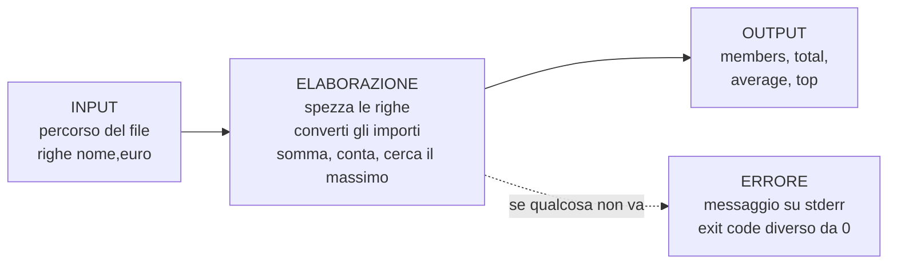
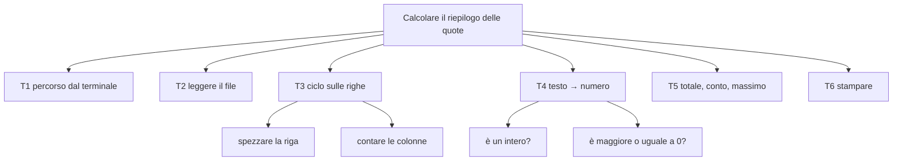
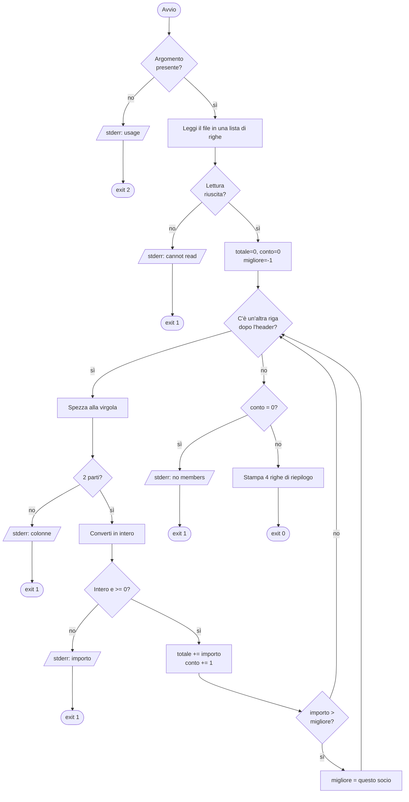
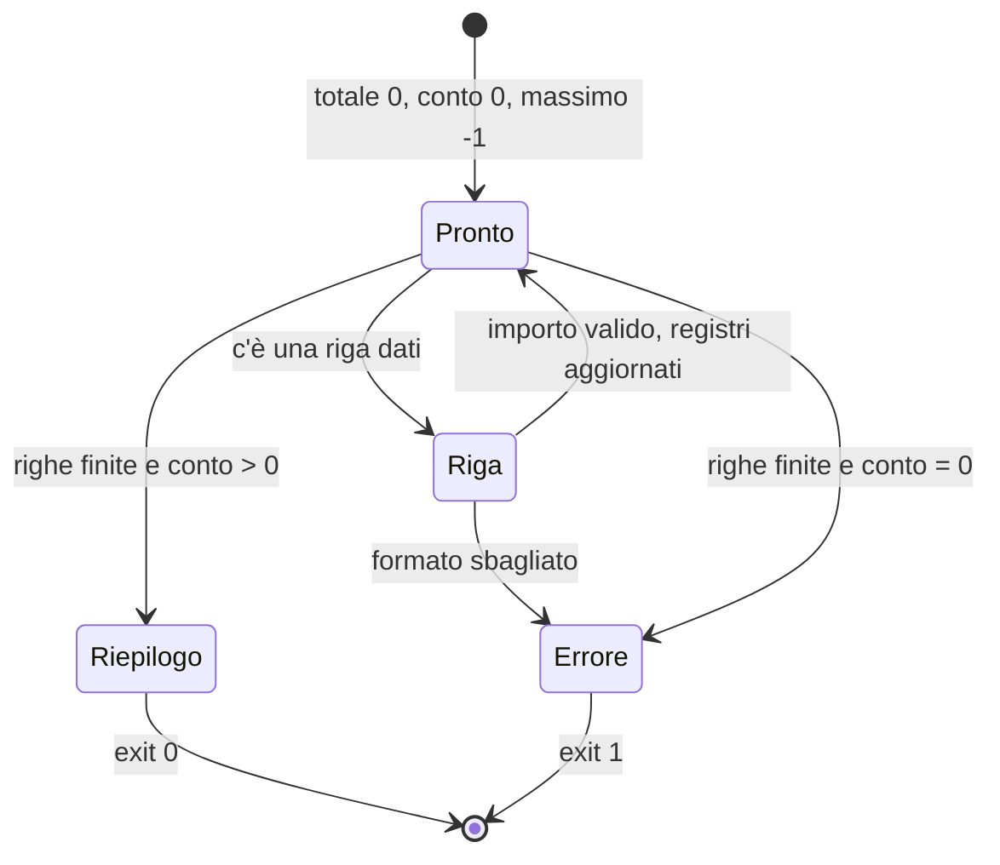
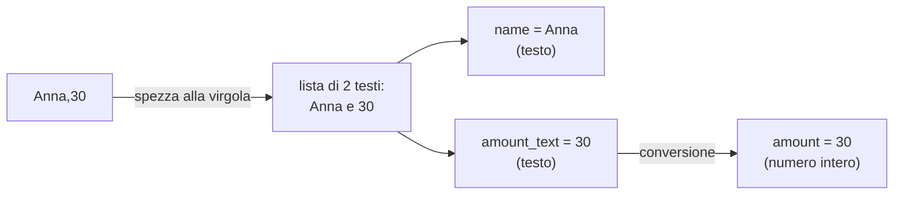

# CP4 — Primo programma e checklist per un linguaggio nuovo

> **Parte P — Propedeutica (solo ingresso A)** · 3 lezioni (LP4.1–LP4.3) · 2,25 ore · formato "primario + lettura"
> **Stato:** bozza 1 (2026-10-11) — secondo capitolo pilota, per l'ingresso A. Codice eseguito e verificato su PHP 8.3.6, Python 3.13.16, Rust 1.97.0, Go 1.24.7 (baseline del corso: PHP 8.4+, Go 1.25+; da riverificare a stesura finale). Questo capitolo non ha matrice degli approcci né addendum: l'obiettivo è costruire gli schemi di base prima del confronto (TOC §9, Parte P).

## Come si usa questo capitolo

Tu **scrivi** nel linguaggio primario che hai scelto in LP1.3 e **leggi** gli altri tre. Per questo ogni passo del programma è mostrato nei quattro linguaggi, nello stesso ordine: PHP, Python, Rust, Go. Quando scrivi, segui solo il tuo; quando leggi (LP4.2), confronta i quattro. Se non riconosci una parola, non fermarti: ogni costrutto nuovo è spiegato la prima volta che compare, e tornerà nei capitoli indicati.

| Lezione | Durata | Che cosa fai | Come |
|---|---|---|---|
| LP4.1 — Dal problema al codice | 45′ | Scrivi un programma completo, a passi | Nel linguaggio primario |
| LP4.2 — Leggere codice altrui | 45′ | Riconosci lo stesso programma negli altri tre | Lettura guidata |
| LP4.3 — La checklist | 45′ | Costruisci lo strumento per ogni linguaggio futuro | Scheda + applicazione a un quinto linguaggio |

## Obiettivi

Al termine del capitolo sai: (1) partire da un problema scritto in italiano e arrivare a un programma funzionante passando per scomposizione, pseudocodice e flowchart; (2) eseguire un programma da terminale, passandogli un argomento, e interpretarne l'**exit code**; (3) usare le sei costruzioni di base — variabile, condizione, ciclo, conversione di tipo, stringa formattata, contatore/accumulatore — in un programma reale; (4) leggere lo stesso programma in un linguaggio che non hai scritto e trovare le parti corrispondenti; (5) compilare la **checklist per un linguaggio nuovo** e usarla su un quinto linguaggio senza averlo mai studiato.

## Il problema reale

> Il tesoriere di un circolo scacchistico tiene in un file di testo le quote versate dai soci: una riga per socio, con il nome e l'importo in euro interi. A fine mese vuole sapere **quanti soci hanno pagato, quanto è stato incassato in totale, qual è la quota media e chi ha versato di più**. Il file è compilato a mano: può mancare, essere vuoto, o contenere righe sbagliate (un importo scritto a lettere, una riga senza importo, un importo negativo). In quei casi il programma deve **dirlo chiaramente e fermarsi**, senza stampare numeri sbagliati.

File di esempio usato in tutto il capitolo, `members.csv`:

```csv
name,euro
Anna,30
Bruno,45
Carla,30
Dario,60
Elena,25
```

(`csv` sta per *comma-separated values*: testo in cui i campi di una riga sono separati da virgole. La prima riga, l'**header**, dà il nome alle colonne e non contiene dati.)

Risultato atteso — identico nei quattro linguaggi:

```text
members=5
total=190
average=38.0
top=Dario (60)
```

### Dal testo al programma: input, elaborazione, output

Ogni programma, anche il più grande, ha la forma vista in LP1.1. Qui:



Nota la freccia tratteggiata: **un programma serio descrive anche come fallisce**. È una scelta di progetto fatta qui, non un dettaglio aggiunto dopo.

### Scomposizione in attività

Un problema grande si risolve riducendolo a problemi piccoli, ciascuno risolvibile da solo (LP2.1). Le sei attività sono anche i sei commenti numerati che trovi nel codice.

| # | Attività | Costrutto che si impara | Passo |
|---|---|---|---|
| T1 | Leggere il percorso del file dalla riga di comando | Argomenti, condizione `if`, exit code | 1 |
| T2 | Leggere tutto il file in una lista di righe | File, lista/array, gestione dell'errore di apertura | 2 |
| T3 | Visitare ogni riga dopo l'header e spezzarla in nome e importo | Ciclo, stringa → lista, numero di riga | 3 |
| T4 | Convertire l'importo da testo a numero e controllarlo | Conversione di tipo, validazione | 4 |
| T5 | Aggiornare totale, contatore e massimo | Variabili come "stato", accumulatore | 5 |
| T6 | Stampare il risultato | Stringa formattata, formato dei decimali | 6 |



### L'algoritmo in pseudocodice e in flowchart

Prima di scrivere in qualunque linguaggio si scrive **che cosa fare**, in italiano strutturato. Il pseudocodice che segue è la "lingua franca" del capitolo: i quattro programmi lo traducono riga per riga.

```text
leggi il percorso dall'argomento; se manca, esci con codice 2
leggi il file in una lista di righe; se non si può, errore ed esci con 1
totale ← 0; conto ← 0; migliore_nome ← ""; migliore_importo ← -1
per ogni riga dopo la prima (numero di riga n da 2):
    spezza la riga alla virgola
    se le parti non sono 2: errore ed esci con 1
    converti la seconda parte in intero; se non si può: errore ed esci con 1
    se l'importo è minore di 0: errore ed esci con 1
    totale ← totale + importo
    conto ← conto + 1
    se importo > migliore_importo: migliore_nome ← nome; migliore_importo ← importo
se conto = 0: errore "no members found" ed esci con 1
stampa members, total, average (totale / conto, una cifra decimale), top
esci con 0
```



Leggi il flowchart seguendo con il dito un percorso: *file valido* → in basso a sinistra dopo l'ultima riga; *importo "x"* → esce al ramo `exit 1` di destra. Ogni **rombo** è una domanda con due uscite; ogni **rettangolo** è un'azione; ogni **parallelogramma** è un messaggio all'esterno. Questo è il vocabolario minimo dei diagrammi di flusso del corso.

---

## LP4.1 — Dal problema al codice (45′)

| Fase | Minuti | Contenuto |
|---|---|---|
| Aggancio | 5 | Il problema del tesoriere; pseudocodice sopra |
| Concetto | 10 | Le sei costruzioni; tracing a mano |
| Implementazione | 15 | Scrivi il programma nel primario, un passo alla volta |
| Focus comparativo | 10 | Vedi LP4.2: lettura degli altri tre |
| Consolidamento | 5 | Esercizio e domanda di verifica |

### Concetto 1 — Che cosa fa un programma "dentro"

Un programma è una sequenza di istruzioni che **cambiano lo stato**: l'insieme dei valori che le variabili contengono in un dato momento. Una **variabile** è un nome dato a un valore. Il programma qui ha quattro variabili di stato, che chiameremo i *quattro registri*:

| Registro | Che cosa tiene | Valore iniziale | Perché quel valore |
|---|---|---|---|
| `total` | Somma degli importi finora visti | 0 | Elemento neutro dell'addizione |
| `count` | Quanti soci finora visti | 0 | Nessuno ancora visto |
| `top_amount` | Importo massimo finora visto | -1 | Qualunque importo valido (≥ 0) lo supera al primo confronto |
| `top_name` | Chi ha versato il massimo | testo vuoto | Verrà sostituito al primo socio |

Un registro che parte da un valore neutro e si aggiorna a ogni giro si chiama **accumulatore** (`total`) o **contatore** (`count`); uno che tiene "il migliore finora" si chiama **massimo corrente** (`top_*`). Sono tre idee che troverai in programmi di ogni dimensione.

### Concetto 2 — Seguire il programma a mano (tracing)

Prima di eseguire, simula. Con il file d'esempio, ecco lo stato dopo ogni riga (LP2.3):

| Riga n | Contenuto | amount | total | count | top_amount | top_name | Nota |
|---|---|---|---|---|---|---|---|
| (inizio) | | | 0 | 0 | -1 | "" | |
| 2 | `Anna,30` | 30 | 30 | 1 | 30 | Anna | 30 > -1: nuovo massimo |
| 3 | `Bruno,45` | 45 | 75 | 2 | 45 | Bruno | 45 > 30 |
| 4 | `Carla,30` | 30 | 105 | 3 | 45 | Bruno | 30 > 45? No: resta Bruno |
| 5 | `Dario,60` | 60 | 165 | 4 | 60 | Dario | 60 > 45 |
| 6 | `Elena,25` | 25 | 190 | 5 | 60 | Dario | 25 > 60? No |
| (fine) | | | 190 | 5 | 60 | Dario | media = 190 / 5 = 38.0 |

Il disegno seguente mostra la stessa cosa come macchina a stati: ogni riga valida fa compiere un giro allo stesso anello.



Un'osservazione utile sul confronto `30 > 45` a riga 4: in caso di **parità** il primo socio resta il massimo, perché il confronto è "strettamente maggiore". Cambiare `>` in `>=` cambierebbe il comportamento. Piccole scelte come questa vanno decise e scritte nel problema, non lasciate al caso.

### Concetto 3 — Il percorso dei dati dentro una riga



Attenzione al punto più delicato: `"30"` e `30` **non sono la stessa cosa**. Il primo è un testo di due caratteri; il secondo è un numero con cui si può fare aritmetica. Dopo aver letto un file *tutto è testo*: la conversione è un passo esplicito (o implicito, come vedremo in LP4.3, con conseguenze sorprendenti). In C02 il tema sarà approfondito.

### Implementazione — i sei passi

Prima di tutto, **dove scrivere ed eseguire**. Crea una cartella, copia `members.csv` e crea il file sorgente del tuo linguaggio con il nome indicato. Si lavora da terminale nella cartella (LP3.1).

| | PHP | Python | Rust | Go |
|---|---|---|---|---|
| File sorgente | `members.php` | `members.py` | `members.rs` | `main.go` + `go.mod` |
| Eseguire | `php members.php members.csv` | `python3 members.py members.csv` | `rustc --edition 2024 -O members.rs` poi `./members members.csv` | `go run . members.csv` |
| Controllare l'exit code | `echo $?` subito dopo | `echo $?` | `echo $?` | `echo $?` |

L'**exit code** è un numero intero che il programma restituisce al sistema operativo quando termina: `0` significa "tutto bene", qualsiasi altro valore significa "qualcosa non va". Il terminale lo conserva nella variabile `$?`. È il modo in cui altri programmi (uno scheduler, uno script, una pipeline CI) capiscono com'è andata senza leggere il testo stampato. Qui: `0` ok, `1` errore sui dati o sul file, `2` uso sbagliato (manca l'argomento).

Il file contiene due tipi di output: **stdout** (standard output, per il risultato) e **stderr** (standard error, per i messaggi di errore). Sono due canali separati: `programma > risultato.txt` salva solo il primo. Nel codice, gli errori vanno sempre su stderr.

#### Passo 1 — T1: il percorso dall'argomento

**Concetto.** Il terminale passa al programma le parole scritte dopo il suo nome: `python3 members.py members.csv` consegna `members.csv`. Ogni linguaggio le offre in una lista; la prima posizione contiene il nome del programma stesso, per questo ci aspettiamo **due** elementi (nome + percorso). Una **condizione** (`if`) sceglie tra due strade a seconda che un'affermazione sia vera o falsa; `!=` significa "diverso da".

**PHP**

```php
function main(array $argv): int
{
    // 1. read the file path from the command line
    if (count($argv) !== 2) {
        fwrite(STDERR, "usage: members <file>\n");
        return 2;
    }
    $path = $argv[1];
```

**Python**

```python
def main() -> int:
    # 1. read the file path from the command line
    if len(sys.argv) != 2:
        print("usage: members <file>", file=sys.stderr)
        return 2
    path = sys.argv[1]
```

**Rust**

```rust
fn main() -> ExitCode {
    // 1. read the file path from the command line
    let args: Vec<String> = env::args().collect();
    if args.len() != 2 {
        eprintln!("usage: members <file>");
        return ExitCode::from(2);
    }
    let path = &args[1];
```

**Go**

```go
func run(args []string) int {
	// 1. read the file path from the command line
	if len(args) != 2 {
		fmt.Fprintln(os.Stderr, "usage: members <file>")
		return 2
	}
	path := args[1]
```

Che cosa notare. Il programma è dentro una **funzione** (`def`, `function`, `fn`, `func`): un blocco di istruzioni con un nome, che può restituire un valore (qui l'exit code); funzioni in dettaglio in C04. La funzione principale **restituisce** il codice invece di terminare di colpo: sarà la riga finale a passarlo al sistema operativo. Le posizioni delle liste partono da **0**: la posizione 0 è il nome del programma, la 1 è il primo argomento (in Rust e Go la lista è `args`, in PHP `$argv`, in Python `sys.argv`). In Rust il tipo `Vec<String>` si legge "vettore di stringhe": una lista che può crescere; `&args[1]` significa "prendo in prestito" l'elemento senza spostarlo (C10).

#### Passo 2 — T2: leggere il file

**Concetto.** Leggere un file può fallire (non esiste, nessun permesso). Ogni linguaggio ha un modo diverso di *accorgersene*, ma il programma deve fare la stessa cosa: se non riesce, stampare un messaggio ed uscire con `1`. Il testo del file viene suddiviso in una **lista di righe**.

**PHP**

```php
    // 2. read the whole file as an array of lines (file() returns false on failure;
    //    the @ silences the legacy warning, see C09)
    $lines = @file($path, FILE_IGNORE_NEW_LINES);
    if ($lines === false) {
        fwrite(STDERR, "fatal: cannot read $path\n");
        return 1;
    }
```

**Python**

```python
    # 2. read the whole file as a list of lines
    try:
        with open(path, encoding="utf-8") as f:
            lines = f.read().splitlines()
    except OSError:
        print(f"fatal: cannot read {path}", file=sys.stderr)
        return 1
```

**Rust**

```rust
    // 2. read the whole file into a String
    let content = match fs::read_to_string(path) {
        Ok(text) => text,
        Err(_) => {
            eprintln!("fatal: cannot read {path}");
            return ExitCode::from(1);
        }
    };
```

**Go**

```go
	// 2. read the whole file, then split it into lines
	data, err := os.ReadFile(path)
	if err != nil {
		fmt.Fprintf(os.Stderr, "fatal: cannot read %s\n", path)
		return 1
	}
	lines := strings.Split(strings.TrimRight(string(data), "\n"), "\n")
```

Questo è il primo punto in cui i linguaggi **divergono sull'idea**, non solo sulla sintassi (e il tema di C09 è proprio questo):

| | Come "si accorge" del fallimento | Che cosa guardi nel codice |
|---|---|---|
| PHP | La funzione restituisce `false` invece di una lista | `if ($lines === false)` |
| Python | Lancia un'**eccezione** che interrompe il flusso | `try: ... except OSError:` |
| Rust | La funzione restituisce un valore a due varianti, `Ok(testo)` oppure `Err(motivo)`; il `match` le distingue | `match ... { Ok.. Err.. }` |
| Go | La funzione restituisce **due valori**: il risultato e un `err` che vale `nil` se tutto è andato bene | `if err != nil` |

`Ok`/`Err` in Rust e la coppia `(valore, err)` in Go sono due modi di dire "il fallimento è un valore come gli altri"; in Python l'eccezione "salta" fuori dal normale ordine delle istruzioni. Per ora ti basta riconoscere i quattro schemi; la lezione completa è C09.

In Python, `with open(...) as f:` apre il file e lo **chiude da solo** all'uscita del blocco, anche in caso di errore. In Rust e Go non serve scrivere nulla di simile perché `read_to_string` e `ReadFile` aprono, leggono e chiudono in un colpo solo.

#### Passo 3 — T3: il ciclo sulle righe

**Concetto.** Un **ciclo** ripete un blocco di istruzioni per ogni elemento di una lista. Qui "per ogni riga dopo la prima": si scarta l'header prendendo la lista **a partire dalla posizione 1**. Il contatore `n` tiene il numero di riga *come lo vede una persona* (l'header è la riga 1, il primo dato la riga 2), utile nei messaggi d'errore. `split` (o `explode`) spezza un testo in una lista, usando la virgola come separatore.

**PHP**

```php
    foreach (array_slice($lines, 1) as $i => $line) {
        $n = $i + 2;
        $parts = explode(',', $line);
        if (count($parts) !== 2) {
            fwrite(STDERR, "line $n: expected 2 columns, got " . count($parts) . "\n");
            return 1;
        }
        [$name, $amountText] = $parts;
```

**Python**

```python
    for n, line in enumerate(lines[1:], start=2):
        parts = line.split(",")
        if len(parts) != 2:
            print(f"line {n}: expected 2 columns, got {len(parts)}", file=sys.stderr)
            return 1
        name, amount_text = parts
```

**Rust**

```rust
    for (i, line) in content.lines().enumerate().skip(1) {
        let n = i + 1;
        let parts: Vec<&str> = line.split(',').collect();
        if parts.len() != 2 {
            eprintln!("line {n}: expected 2 columns, got {}", parts.len());
            return ExitCode::from(1);
        }
        let name = parts[0];
        let amount_text = parts[1];
```

**Go**

```go
	for i, line := range lines[1:] {
		n := i + 2
		parts := strings.Split(line, ",")
		if len(parts) != 2 {
			fmt.Fprintf(os.Stderr, "line %d: expected 2 columns, got %d\n", n, len(parts))
			return 1
		}
		name, amountText := parts[0], parts[1]
```

Che cosa notare, in ordine.

1. **Il ciclo ha due modi di dire "con l'indice"**: Python `enumerate(..., start=2)` produce coppie *(numero, riga)* già numerate da 2; Rust `enumerate()` numera da 0 e poi `skip(1)` salta l'header, quindi la riga 2 del file è l'indice 1 → `n = i + 1`; PHP e Go partono da 0 sulla lista già tagliata → `n = i + 2`. È l'errore più comune per chi inizia: **un off-by-one**. La tabella di tracing serve a verificarlo.
2. **Le virgolette**. `"..."` crea un testo; in PHP l'uso di `"..$n.."` inserisce il valore della variabile nel testo (*interpolazione*); in Python lo stesso lo fa la `f` prima delle virgolette (`f"...{n}..."`); in Rust `{n}` dentro `println!`/`eprintln!`; in Go si usano segnaposto (`%d` per un intero, `%s` per un testo) e i valori dopo la virgola.
3. **"Spacchettare" una lista**. `name, amount_text = parts` (Python), `[$name, $amountText] = $parts` (PHP) e `name, amountText := parts[0], parts[1]` (Go) danno un nome a ciascun elemento. In Rust si fa con l'indice `parts[0]`.
4. **Le graffe e l'indentazione**. PHP, Rust e Go delimitano i blocchi con `{ }`; Python con i **due punti** e l'**indentazione** (quattro spazi): in Python lo spazio fa parte della sintassi.
5. **`:=` in Go** *dichiara e assegna*; `=` solo assegna. Il compilatore deduce il tipo dal valore (*inferenza*, C02).

#### Passo 4 — T4: da testo a numero (e controllare)

**Concetto.** La conversione `"30"` → `30` può fallire (`"x"`, `""`, `"3,5"`). Va sempre **controllata**, perché un dato che arriva da fuori non è mai affidabile. Dopo la conversione si controlla anche la regola di dominio: un importo non può essere negativo.

**PHP**

```php
        $amount = filter_var($amountText, FILTER_VALIDATE_INT);
        if ($amount === false) {
            fwrite(STDERR, "line $n: \"$amountText\" is not an integer\n");
            return 1;
        }
        if ($amount < 0) {
            fwrite(STDERR, "line $n: amount must be >= 0, got $amount\n");
            return 1;
        }
```

**Python**

```python
        try:
            amount = int(amount_text)
        except ValueError:
            print(f'line {n}: "{amount_text}" is not an integer', file=sys.stderr)
            return 1
        if amount < 0:
            print(f"line {n}: amount must be >= 0, got {amount}", file=sys.stderr)
            return 1
```

**Rust**

```rust
        let amount: i64 = match amount_text.parse() {
            Ok(value) => value,
            Err(_) => {
                eprintln!("line {n}: \"{amount_text}\" is not an integer");
                return ExitCode::from(1);
            }
        };
        if amount < 0 {
            eprintln!("line {n}: amount must be >= 0, got {amount}");
            return ExitCode::from(1);
        }
```

**Go**

```go
		amount, err := strconv.Atoi(amountText)
		if err != nil {
			fmt.Fprintf(os.Stderr, "line %d: \"%s\" is not an integer\n", n, amountText)
			return 1
		}
		if amount < 0 {
			fmt.Fprintf(os.Stderr, "line %d: amount must be >= 0, got %d\n", n, amount)
			return 1
		}
```

Due cose da fissare. Primo: la conversione è **sempre esplicita** nei quattro programmi (`int()`, `filter_var`, `parse()`, `Atoi`), e ciascuna "dice di no" in modo diverso: valore speciale (`false`), eccezione (`ValueError`), `Err`, secondo valore `err`. Secondo: in Rust scrivere `let amount: i64` obbliga a dichiarare **il tipo**, perché `parse()` può produrre tipi diversi: il compilatore ha bisogno di sapere quale vogliamo. I numeri interi hanno dimensioni diverse (`i64` = intero con segno a 64 bit); in Python non c'è limite, in Go `int` dipende dalla macchina (C02).

Il carattere `\"` dentro un testo è un **escape**: la barra rovesciata fa sì che la virgoletta successiva sia un carattere del testo e non la fine del testo. In Python si può evitare scegliendo le virgolette semplici all'esterno: `f'line {n}: "{amount_text}" ...'`.

#### Passo 5 — T5: aggiornare lo stato

**Concetto.** Il cuore del ciclo, dove gli accumulatori fanno il loro lavoro. È il primo contatto con le **variabili che cambiano** (*mutabilità*) e con le tre forme di assegnazione: inizializzazione (prima del ciclo), incremento (`+=`, "aggiungi a se stessa") e sostituzione condizionale (il massimo).

**PHP**

```php
    // before the loop
    $total = 0;
    $count = 0;
    $topName = '';
    $topAmount = -1; // any valid amount (>= 0) is greater than this
    // ... inside the loop
        $total += $amount;
        $count++;
        if ($amount > $topAmount) {
            $topName = $name;
            $topAmount = $amount;
        }
```

**Python**

```python
    # before the loop
    total = 0
    count = 0
    top_name = ""
    top_amount = -1  # any valid amount (>= 0) is greater than this
    # ... inside the loop
        total += amount
        count += 1
        if amount > top_amount:
            top_name = name
            top_amount = amount
```

**Rust**

```rust
    // before the loop
    let mut total: i64 = 0;
    let mut count: usize = 0;
    let mut top_name = String::new();
    let mut top_amount: i64 = -1; // any valid amount (>= 0) is greater than this
    // ... inside the loop
        total += amount;
        count += 1;
        if amount > top_amount {
            top_name = name.to_string();
            top_amount = amount;
        }
```

**Go**

```go
	// before the loop
	total := 0
	count := 0
	topName := ""
	topAmount := -1 // any valid amount (>= 0) is greater than this
	// ... inside the loop
		total += amount
		count++
		if amount > topAmount {
			topName = name
			topAmount = amount
		}
```

La differenza più istruttiva è in Rust: `let mut`. In Rust le variabili sono **immutabili per default**; per poterle cambiare devi dichiararlo con `mut`, e questa parola è un segnale a chi legge: "questo valore cambierà". In Python, PHP e Go ogni variabile può essere riassegnata. In Rust `name` è un `&str` (un testo in prestito dalla riga) e `top_name` è una `String` (un testo posseduto): per conservare il nome oltre il giro del ciclo serve `to_string()`, che ne fa una copia. Il perché è in C10; per ora basta sapere che, quando un valore in prestito deve sopravvivere al giro del ciclo, **una prima soluzione è farne una copia** con `to_string()`.

`count++` (PHP, Go) e `count += 1` (Python, Rust) fanno la stessa cosa: Python e Rust non hanno `++`.

#### Passo 6 — T6: guardare se non è vuoto, poi stampare

**Concetto.** Dopo il ciclo, prima della divisione per `count`, un controllo: se non c'è stato nessun socio, `total / count` sarebbe una **divisione per zero**. È un *caso limite* (edge case): input vuoto o con solo l'header. Si risolve con una condizione **prima** di dividere. Poi si stampa, formattando la media a **una cifra decimale** (`38.0` e non `38` o `38.00000001`).

**PHP**

```php
    if ($count === 0) {
        fwrite(STDERR, "no members found\n");
        return 1;
    }

    // 6. print the result
    echo "members=$count\n";
    echo "total=$total\n";
    echo 'average=' . sprintf('%.1f', $total / $count) . "\n";
    echo "top=$topName ($topAmount)\n";
    return 0;
}

exit(main($argv));
```

**Python**

```python
    if count == 0:
        print("no members found", file=sys.stderr)
        return 1

    # 6. print the result
    print(f"members={count}")
    print(f"total={total}")
    print(f"average={total / count:.1f}")
    print(f"top={top_name} ({top_amount})")
    return 0


if __name__ == "__main__":
    sys.exit(main())
```

**Rust**

```rust
    if count == 0 {
        eprintln!("no members found");
        return ExitCode::from(1);
    }

    // 6. print the result
    println!("members={count}");
    println!("total={total}");
    println!("average={:.1}", total as f64 / count as f64);
    println!("top={top_name} ({top_amount})");
    ExitCode::SUCCESS
}
```

**Go**

```go
	if count == 0 {
		fmt.Fprintln(os.Stderr, "no members found")
		return 1
	}

	// 6. print the result
	fmt.Printf("members=%d\n", count)
	fmt.Printf("total=%d\n", total)
	fmt.Printf("average=%.1f\n", float64(total)/float64(count))
	fmt.Printf("top=%s (%d)\n", topName, topAmount)
	return 0
}

func main() { os.Exit(run(os.Args)) }
```

**Dividere due interi: la prima trappola.** `190 / 5` deve dare `38.0`. Ma in Rust e Go, la divisione tra due interi dà un intero (qui 38) e per ottenere un decimale devi **convertire esplicitamente** gli operandi in numeri a virgola mobile (`as f64`, `float64(...)`). In Python `/` dà sempre un decimale (`//` dà la divisione intera); in PHP `/` dà un intero solo se il resto è zero. In tutti e quattro il formato `.1f` / `%.1f` decide la **precisione di stampa**. Questa è la ragione per cui conviene sempre testare con un esempio il cui risultato si conosce a mano (qui 38.0).

**Il punto d'ingresso.** L'ultima riga di ogni linguaggio *avvia* la funzione e consegna il codice al sistema operativo: `exit(main($argv))` (PHP), `sys.exit(main())` (Python, protetto da `if __name__ == "__main__":` perché lo stesso file possa anche essere importato da un altro programma senza eseguirsi), `ExitCode` restituito da `main` (Rust: il tipo di ritorno di `main` *è* il canale verso il sistema operativo), `os.Exit(run(...))` (Go).

### Verifica: eseguire e confrontare

Esegui con il file d'esempio e controlla stdout ed exit code:

```console
$ python3 members.py members.csv; echo "exit=$?"
members=5
total=190
average=38.0
top=Dario (60)
exit=0
```

Poi **rompi di proposito** l'input e verifica che il programma si comporti come previsto. Questa è la tabella di collaudo (ogni riga è un test: stesso input, stesso esito nei quattro linguaggi — verificato).

| Caso | Contenuto del file | stderr | exit |
|---|---|---|---|
| Valido | `members.csv` come sopra | — (stdout: 4 righe) | 0 |
| File mancante | `nofile.csv` non esiste | `fatal: cannot read nofile.csv` | 1 |
| Importo non numerico | `Anna,30` / `Bruno,x` | `line 3: "x" is not an integer` | 1 |
| Importo vuoto | `Anna,` | `line 2: "" is not an integer` | 1 |
| Colonna mancante | `Anna` | `line 2: expected 2 columns, got 1` | 1 |
| Importo negativo | `Anna,-5` | `line 2: amount must be >= 0, got -5` | 1 |
| Solo header | `name,euro` | `no members found` | 1 |
| Nessun argomento | — | `usage: members <file>` | 2 |

Scrivere i test *prima* o *insieme* al codice è una buona abitudine (C13). Per ora il rituale è: eseguire il caso valido, poi ciascuno dei casi sbagliati, e leggere il messaggio.

### Focus comparativo

| Aspetto | PHP | Python | Rust | Go |
|---|---|---|---|---|
| Variabile | `$total = 0;` | `total = 0` | `let mut total: i64 = 0;` | `total := 0` |
| Fine istruzione | `;` obbligatorio | A capo | `;` obbligatorio | A capo |
| Blocchi | `{ }` | `:` + indentazione | `{ }` | `{ }` |
| Testo con valori dentro | `"x=$x"` | `f"x={x}"` | `println!("x={x}")` | `Printf("x=%d", x)` |
| Il fallimento di una conversione | `false` | eccezione | `Err(..)` | secondo valore `err` |
| Divisione tra interi | `/` dà decimale se serve | `/` sempre decimale | `/` intera: serve `as f64` | `/` intera: serve `float64()` |
| Variabile modificabile | Sempre | Sempre | Solo con `mut` | Sempre |

**Similitudini.** I quattro programmi hanno le **stesse sei parti, nello stesso ordine**, e lo stesso flusso di controllo. Chi sa leggere uno sa trovare i corrispondenti negli altri in pochi secondi.
**Differenze.** Le differenze di sintassi (graffe contro indentazione, `;`, `$`) sono superficiali; quelle di *idea* sono tre: come si segnala un fallimento (valore speciale, eccezione, `Err`, coppia), se una variabile può cambiare per default, e quanto il linguaggio chiede di dichiarare i tipi.

### Esercizio Rosetta (5′) e domanda di verifica

**Esercizio.** Cambia il programma perché `top` stampi **anche il nome di chi è secondo**, oppure — più semplice — perché in caso di parità sul massimo vinca l'**ultimo** socio invece del primo. Quale riga cambia, e di quale carattere? Verifica con un file a due soci con la stessa quota.

**Domanda di verifica.** Perché `top_amount` parte da `-1` e non da `0`? Che cosa andrebbe storto con un file in cui tutti hanno versato `0`?

**Risposte**

> Per la parità: `>` diventa `>=`. Con `top_amount` iniziale `0`, un file in cui tutti versano `0` non supera mai il confronto `0 > 0`, e `top_name` resterebbe vuoto: stamperebbe `top= (0)`. Con `-1` il primo socio vince sempre il primo confronto.

---
