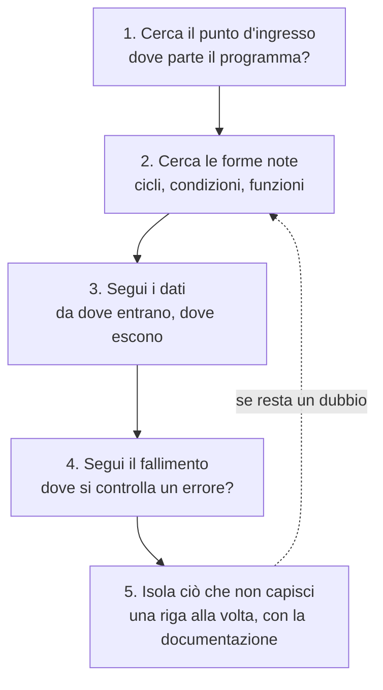
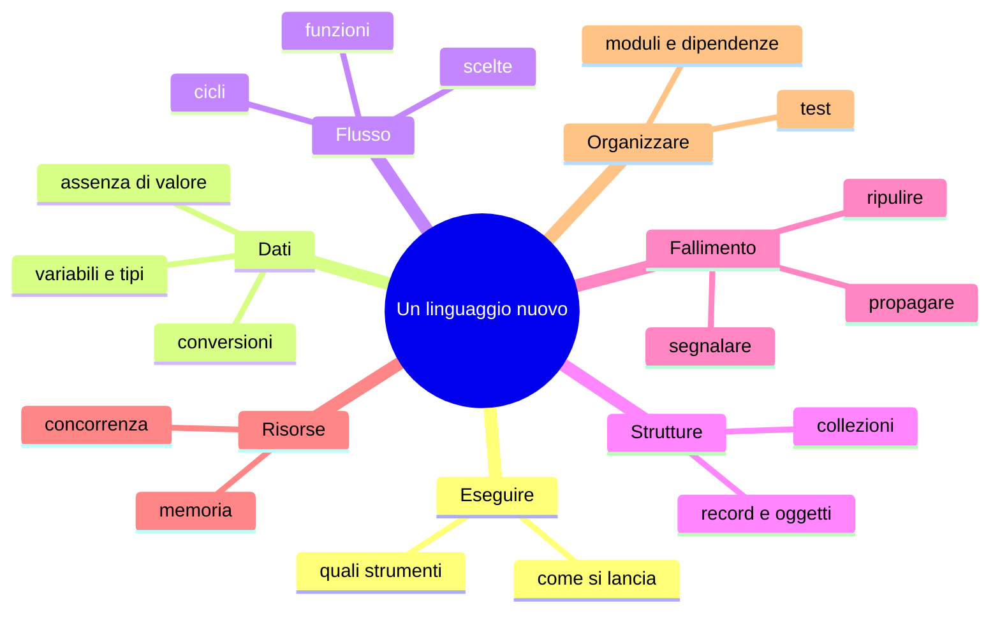
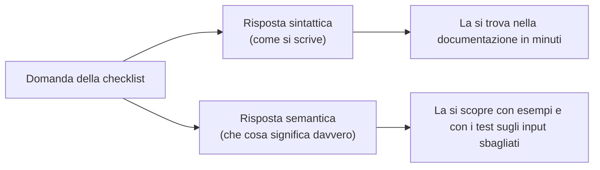
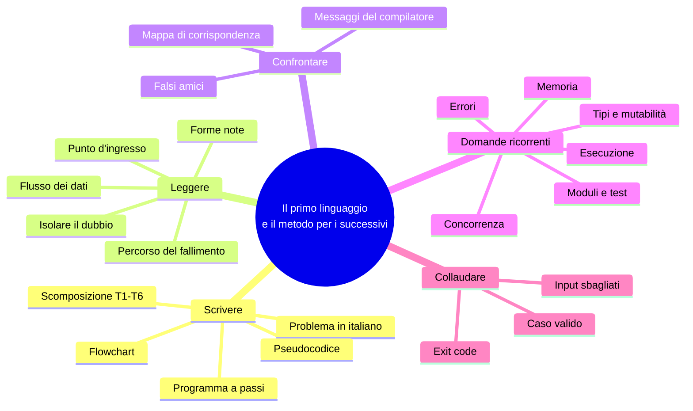

## LP4.2 — Leggere codice altrui: lo stesso programma negli altri tre (45′)

| Fase | Minuti | Contenuto |
|---|---|---|
| Aggancio | 5 | Hai scritto un programma; ora ne apri uno scritto da altri, in un linguaggio mai visto |
| Concetto | 10 | La lettura come tecnica: cinque passi |
| Implementazione | 15 | Mappa di corrispondenza T1–T6 e lettura degli errori del compilatore |
| Focus comparativo | 10 | Falsi amici e parole che non si assomigliano |
| Consolidamento | 5 | Esercizio di lettura e domanda di verifica |

### Concetto — leggere non è tradurre

Nella vita professionale si legge molto più codice di quanto se ne scriva, e quasi mai nel proprio linguaggio preferito. Leggere un linguaggio sconosciuto **non richiede di conoscerlo**: richiede di sapere *che cosa cercare*. Il programma che hai appena scritto ha una struttura che si ritrova, quasi uguale, in tutti i programmi di questo tipo. Il metodo ha cinque passi:



Applicato ai nostri programmi:

1. **Punto d'ingresso.** Cerca l'ultima riga o la funzione `main`: `exit(main($argv))` in PHP; `if __name__ == "__main__"` in Python; `fn main()` in Rust; `func main()` in Go. In 5 secondi sai da dove partire.
2. **Forme note.** Cerca le parole che segnalano un ciclo (`foreach`, `for`), una scelta (`if`) e una funzione (`function`, `def`, `fn`, `func`). Non importa la punteggiatura attorno.
3. **Dati.** Segui il nome `amount_text` (o `$amountText`, o `amountText`): nasce da `parts`, viene convertito in `amount`, finisce in `total`. Il flusso è la spina dorsale di qualunque programma.
4. **Fallimento.** Cerca dove si stampa su stderr e dove si esce con un codice diverso da 0 (`return 1`, `ExitCode::from(1)`). Sono i punti in cui l'autore ha deciso "qui non si può proseguire".
5. **Isola.** Se una riga resta oscura (`[$name, $amountText] = $parts;`, `.enumerate().skip(1)`), non bloccarti: chiediti che *tipo di cosa* sta producendo (una lista? un numero?) e cerca solo quel costrutto.

### Mappa di corrispondenza T1–T6

Cerca la stessa attività in ciascun linguaggio: è la tabella da tenere accanto quando leggi.

| Attività | PHP | Python | Rust | Go |
|---|---|---|---|---|
| T1 argomenti | `$argv`, `count()` | `sys.argv`, `len()` | `env::args().collect()` | `os.Args` passato a `run()` |
| T2 leggere il file | `file()` | `open()` + `splitlines()` | `fs::read_to_string()` | `os.ReadFile()` + `Split()` |
| T3 ciclo | `foreach (array_slice(...) as $i => $line)` | `for n, line in enumerate(lines[1:], start=2)` | `for (i, line) in content.lines().enumerate().skip(1)` | `for i, line := range lines[1:]` |
| T3 spezzare | `explode(',', $line)` | `line.split(",")` | `line.split(',').collect()` | `strings.Split(line, ",")` |
| T4 conversione | `filter_var(..., FILTER_VALIDATE_INT)` | `int(...)` in `try` | `.parse()` in `match` | `strconv.Atoi()` |
| T5 stato | `$total += ...` | `total += ...` | `total += ...` (con `let mut`) | `total += ...` |
| T6 stampa | `echo`, `sprintf('%.1f')` | `print(f"...:.1f")` | `println!("{:.1}")` | `fmt.Printf("%.1f")` |
| Uscita | `return 1;` / `exit(main(...))` | `return 1` / `sys.exit(...)` | `return ExitCode::from(1)` | `return 1` / `os.Exit(run(...))` |

### Leggere i messaggi del compilatore e dell'interprete

Un'abilità di lettura essenziale è capire **che cosa dice** il messaggio d'errore. Sono tutti veri, ottenuti rompendo di proposito il programma (CP3 ne approfondirà la lettura).

**Rust — modifichi una variabile che non è `mut`:**

```text
error[E0384]: cannot assign twice to immutable variable `total`
 --> a.rs:3:5
2 |     let total: i64 = 0;
  |         ----- first assignment to `total`
3 |     total += 30;
  |     ^^^^^^^^^^^ cannot assign twice to immutable variable
help: consider making this binding mutable
2 |     let mut total: i64 = 0;
  |         +++
```

Il messaggio dice *dove* (file, riga, colonna), *che cosa* (assegnazione doppia a una variabile immutabile) e **come correggere** (`+++` mostra le lettere da aggiungere). Il compilatore Rust è il più prolisso dei quattro, nel senso buono.

**Go — una variabile dichiarata e mai usata:**

```text
./b.go:7:2: declared and not used: count
```

Go rifiuta di compilare se una variabile locale non è usata. È una scelta: un programma con variabili inutilizzate è quasi sempre un errore di battitura o un resto di una modifica.

**Python — indentazione incoerente:**

```text
File "c.py", line 3
    total += 30
               ^
IndentationError: unindent does not match any outer indentation level
```

In Python i blocchi esistono *grazie* all'indentazione: se la riga 3 rientra di due spazi quando il blocco ne usa quattro, il programma non è nemmeno valido.

**PHP — tipo sbagliato con `declare(strict_types=1)`:**

```text
PHP Fatal error:  Uncaught TypeError: add(): Argument #1 ($a) must be of type int, string given
```

Con `strict_types` PHP rifiuta di convertire in silenzio `"30"` in `30` quando una funzione dichiara `int`. Senza quella riga convertirebbe, e il programma farebbe la cosa "giusta" per caso: PHP e JavaScript sono i due linguaggi più generosi nelle conversioni implicite (LP4.3 ne mostra un caso reale).

**Rust — tipi numerici diversi nella stessa operazione:**

```text
error[E0277]: cannot divide `i64` by `usize`
```

Rust non divide un `i64` per un `usize` senza una conversione esplicita. Per questo il programma scrive `total as f64 / count as f64`. È la stessa regola vista nel passo 6, con un'altra faccia.

**Go — la trappola della divisione intera:** il codice `float64(total / count)` compila e gira, ma divide *prima* (tra interi) e converte *dopo*: con `total=191`, `count=5` stampa `38`, non `38.2`. Il compilatore non avvisa, perché il programma è corretto: sbagliata è l'intenzione. Il rimedio è convertire **prima** della divisione: `float64(total) / float64(count)`.

### Focus comparativo — falsi amici e parole diverse per la stessa idea

| Idea | PHP | Python | Rust | Go | Attenzione |
|---|---|---|---|---|---|
| Lunghezza di una lista | `count($a)` | `len(a)` | `a.len()` | `len(a)` | In Rust è un **metodo** (si scrive dopo il punto), negli altri una funzione |
| Nessun valore | `null` | `None` | `Option::None` | `nil` | Non si scrivono allo stesso modo né significano la stessa cosa (C02) |
| Funzione | `function` | `def` | `fn` | `func` | Stessa idea, quattro parole |
| Stampa | `echo` | `print` | `println!` | `fmt.Println` | In Rust il `!` indica una **macro**, non una funzione |
| Testo vs. carattere | `'a'` e `"a"` sono due modi di scrivere un testo | `'a'` e `"a"` uguali | `'a'` è un **carattere**, `"a"` un testo | `'a'` è un **byte/rune**, `"a"` un testo | `','` in Rust ≠ `","` |
| `&` | riferimento (raro) | non esiste | **prestito** della variabile | **indirizzo** di una variabile | Stesso simbolo, concetti diversi (C10) |
| Commento | `//`, `#`, `/* */` | `#` | `//` | `//` | |

**Similitudini.** Dopo i primi minuti di lettura, la struttura salta fuori da sola: un'intestazione, un ciclo, tre o quattro `if`, una stampa finale. Quello che sembra "un altro mondo" è per l'80% punteggiatura.
**Differenze.** Il restante 20% è dove si nascondono le idee: un `?` o un `!` o un `&` o un `mut` portano con sé una parte del modello del linguaggio. Annotali: sono le voci del capitolo corrispondente.

### Esercizio Rosetta (5′) e domanda di verifica

**Esercizio di lettura.** Senza eseguire nulla, rispondi usando solo i quattro programmi di fianco. (a) In quale linguaggio il programma scarta l'header con una funzione che *salta* un elemento invece di tagliare la lista? (b) Dove si decide che l'exit code è 1 quando manca una colonna? (c) Quale dei quattro programmi ha il minor numero di righe nel ciclo e perché? (d) Quale linguaggio avvisa se `count` non viene usato?

**Domanda di verifica.** Un collega ti chiede: "ho una variabile `x` che vale `"5"` e una `y` che vale `3`; in quale dei quattro linguaggi `x + y` dà 8, in quale 53, in quale un errore?" (la risposta completa è in LP4.3: dovrai ricordarti di quale controllo fare).

**Risposte**

> (a) Rust: `.skip(1)` sull'iteratore; negli altri si taglia la lista con `array_slice($lines, 1)` / `lines[1:]`. (b) Nel ramo `if len(parts) != 2` / `count($parts) !== 2` / `parts.len() != 2` / `len(parts) != 2`, con `return 1`. (c) Python: spacchetta la lista, numera e itera con una sola costruzione (`for n, line in enumerate(...)`), senza gestire a mano indice e tagli. (d) Go (non compila); gli altri tre non avvisano per default.

---

## LP4.3 — La checklist per un linguaggio nuovo (45′)

| Fase | Minuti | Contenuto |
|---|---|---|
| Aggancio | 5 | Tra due anni uscirà un nuovo linguaggio: come lo si impara in fretta? |
| Concetto | 10 | Le domande ricorrenti: ogni linguaggio le deve risolvere tutte |
| Implementazione | 15 | Compila la checklist con i quattro programmi; usala sul quinto |
| Focus comparativo | 10 | Che cosa la checklist non sa dirti |
| Consolidamento | 5 | Schedina stampabile e domanda di verifica |

### Concetto — poche domande, valide per tutti

Ogni linguaggio di uso generale deve rispondere alle stesse domande, perché ogni programma deve fare le stesse cose: avviarsi, memorizzare, decidere, ripetere, strutturare i dati, fallire, organizzarsi. Dopo aver letto quattro versioni dello stesso programma, ora sai distinguere **le domande** dalle **risposte**. Le domande sono la checklist; le risposte cambiano.



### La checklist, compilata con i nostri quattro programmi

Ogni domanda è collegata al capitolo che la approfondisce (TOC, LP4.3). Le risposte qui sono quelle che si ricavano **solo da questo programma**: per ora basta e avanza.

| # | Domanda | PHP | Python | Rust | Go | Approfondisce |
|---|---|---|---|---|---|---|
| 1 | Come si esegue e con quali strumenti? | `php file.php` (interprete) | `python3 file.py` (interprete) | `rustc` compila, poi si esegue il binario | `go run .` compila ed esegue (o `go build`) | C00, C01 |
| 2 | Come dichiara variabili e tipi? | `$x = 0;` — tipo implicito; `declare(strict_types=1)` per i controlli | `x = 0` — tipo implicito | `let x: i64 = 0;` — tipo dichiarato o dedotto | `x := 0` oppure `var x int` | C02 |
| 3 | Una variabile può cambiare? | Sì | Sì | **Solo con `mut`** | Sì | C02 |
| 4 | Come rappresenta l'assenza di valore? | `null`; nel programma `false` come "errore" | `None`; (non usato) | `Option` / `Result` (vedi `Ok`/`Err`) | `nil` (nell'`err`) | C02 |
| 5 | Come esprime scelte e cicli? | `if`, `foreach` | `if`, `for ... in` | `if`, `for ... in`, `match` | `if`, `for ... range` | C03 |
| 6 | Come si scrive una funzione? | `function main(array $argv): int` | `def main() -> int:` | `fn main() -> ExitCode` | `func run(args []string) int` | C04 |
| 7 | Quali collezioni offre? | `array` (lista e mappa insieme) | `list` | `Vec<T>` | slice `[]T` | C05 |
| 8 | Come modella dati e comportamento? | Classi (non servite qui) | Classi, `dataclass` (non servite qui) | `struct`, `enum` (non servite qui) | `struct` (non servite qui) | C06, C07 |
| 9 | Come segnala e propaga gli errori? | Valore `false`, eccezioni | Eccezioni (`try/except`) | `Result` con `Ok`/`Err` | Secondo valore `err` | C09 |
| 10 | Chi gestisce la memoria? | Il runtime | Il runtime | Il compilatore (ownership) | Il runtime (garbage collector) | C10 |
| 11 | Come fa più cose insieme? | — (non servito qui) | — | — | — | C11 |
| 12 | Come organizza il codice e le dipendenze? Come si testa? | — (un solo file qui) | — | — | `go.mod` | C12, C13 |

Le righe 8, 11 e 12 hanno poche risposte **ed è giusto così**: il programma di oggi non ne ha avuto bisogno. La checklist non è un esame che si supera subito, ma una mappa dei buchi: ogni cella vuota è un capitolo che verrà.

### Il trucco: aggiungi una colonna

La checklist è uno strumento per **un quinto** linguaggio. Di seguito lo stesso programma in JavaScript (Node.js). Non lo abbiamo mai studiato: compila la colonna per lui, usando solo ciò che vedi.

```javascript
const fs = require("fs");

function main(argv) {
  // 1. read the file path from the command line
  if (argv.length !== 3) {
    console.error("usage: members <file>");
    return 2;
  }
  const path = argv[2];

  // 2. read the whole file
  let content;
  try {
    content = fs.readFileSync(path, "utf-8");
  } catch {
    console.error(`fatal: cannot read ${path}`);
    return 1;
  }
  const lines = content.split("\n").filter((l, i, a) => !(i === a.length - 1 && l === ""));

  let total = 0, count = 0, topName = "", topAmount = -1;
  for (const [i, line] of lines.slice(1).entries()) {
    const n = i + 2;
    const parts = line.split(",");
    if (parts.length !== 2) {
      console.error(`line ${n}: expected 2 columns, got ${parts.length}`);
      return 1;
    }
    const [name, amountText] = parts;
    const amount = Number(amountText);
    if (!Number.isInteger(amount)) {
      console.error(`line ${n}: "${amountText}" is not an integer`);
      return 1;
    }
    if (amount < 0) {
      console.error(`line ${n}: amount must be >= 0, got ${amount}`);
      return 1;
    }
    total += amount;
    count += 1;
    if (amount > topAmount) { topName = name; topAmount = amount; }
  }
  if (count === 0) { console.error("no members found"); return 1; }
  console.log(`members=${count}`);
  console.log(`total=${total}`);
  console.log(`average=${(total / count).toFixed(1)}`);
  console.log(`top=${topName} (${topAmount})`);
  return 0;
}

process.exit(main(process.argv));
```

Prova la checklist su questa riga per riga: come si esegue (`node members.js members.csv`), come dichiara variabili (`const` e `let`), come segnala gli errori (`try`/`catch`, ma anche `console.error` + `return 1`), come spezza il testo (`split`), come converte (`Number(...)`). Con i quattro programmi sotto gli occhi, la maggior parte si riconosce **per analogia**.

**La trappola.** Esegui questo caso: un file con la riga `Anna,` (importo vuoto).

| Linguaggio | Esito con `Anna,` |
|---|---|
| PHP, Python, Rust, Go | `line 2: "" is not an integer` — exit 1 |
| **JavaScript** | `members=1 total=0 average=0.0 top=Anna (0)` — **exit 0** |

`Number("")` in JavaScript non fallisce: **restituisce `0`**. È una conversione implicita permissiva: il testo vuoto "diventa" zero senza avvisare. Il programma è *identico* nella struttura, ma accetta come valido un dato che gli altri quattro rifiutano. Questo è il caso concreto che la checklist non può prevedere da sola: la domanda "come gestisce le conversioni?" ha risposto, ma solo un **test con dati sbagliati** lo ha fatto emergere. Ne ricavi la regola operativa di tutto il corso:

> **Per ogni linguaggio nuovo, compila la checklist, poi scrivi i test dei casi sbagliati.**

### Focus comparativo — che cosa la checklist non sa dirti



**Similitudini.** Le domande sono le stesse per tutti i linguaggi; il vocabolario di analisi (variabile, tipo, ciclo, errore, risorsa) si trasferisce.
**Differenze.** La **sintassi** si impara in un pomeriggio; la **semantica** (cosa succede con `""`, con `null`, con un overflow, con due thread) richiede settimane di pratica. La seconda è dove il corso passerà il tempo.

### Consolidamento (5′) — la schedina stampabile

Ritaglia, compila una per ogni linguaggio nuovo. Una riga basta per cella.

```text
Linguaggio: ____________   Versione: ______   Data: ________

 1. Come lo eseguo?                        ______________________
 2. Come dichiaro una variabile / un tipo? ______________________
 3. Una variabile può cambiare?            ______________________
 4. Come dice "nessun valore"?             ______________________
 5. if / for / switch-match                ______________________
 6. Come scrivo una funzione?              ______________________
 7. Lista, mappa, insieme                  ______________________
 8. Record, classe, enum                   ______________________
 9. Come segnala un errore? E lo propaga?  ______________________
10. Chi libera la memoria?                 ______________________
11. Come faccio più cose insieme?          ______________________
12. Moduli, dipendenze, test               ______________________

 Test sugli input sbagliati:  "" / "x" / -1 / file mancante / vuoto
 Esito: _________________________________________________________
```

**Domanda di verifica.** Nella checklist, perché la domanda 3 ("una variabile può cambiare?") sta vicino alla 2 e non alla 5?

**Risposta**

> Perché mutabilità e tipi sono due facce di come il linguaggio tratta un **valore**: cosa può contenere e se può essere sostituito. Il flusso di controllo (domanda 5) usa i valori ma non li definisce.

---

## Errori tipici di chi inizia

| Errore | Dove si vede | Perché succede | Rimedio |
|---|---|---|---|
| Off-by-one sul numero di riga | Messaggio "line 3" per la riga sbagliata | `enumerate`, `skip`, `slice` partono da 0 | Tracing con una riga nota (Bruno,x = riga 3) |
| Dividere due interi | `average=38` invece di `38.0`; con 191/5 stampa `38` invece di `38.2` | In Rust e Go la divisione intera scarta il resto | Convertire **prima** della divisione |
| Dimenticare `return` dopo un errore | Il programma stampa l'errore, poi continua | L'errore è stato segnalato ma non gestito | Ogni messaggio su stderr è seguito da un `return` con codice |
| Tutto su stdout | Gli errori finiscono nel file con il risultato | `print` scrive su stdout | Errori su stderr |
| Indentazione mista in Python | `IndentationError` | Tab e spazi insieme, o numero di spazi diverso | Un editor che mostra gli spazi; 4 spazi |
| Dimenticare `;` in PHP/Rust | `Parse error` / `expected ;` | La riga non termina | Leggere il messaggio: indica la riga *dopo* quella sbagliata |
| Variabile `mut` mancante in Rust | `cannot assign twice` | Immutabile per default | Il messaggio suggerisce la correzione |
| Confrontare `=` con `==` | Condizione sempre vera o errore | `=` assegna, `==` confronta | Dopo `if`, sempre `==` o `!=` o `>` |
| Fidarsi dell'input | Il programma "funziona" con dati sbagliati | Nessun test sugli input sbagliati | La tabella di collaudo |

## Quiz di verifica

1. Qual è la differenza tra stdout e stderr, e perché i messaggi di errore vanno su stderr?
2. Che valore ha l'exit code di un programma che termina senza problemi? E perché esiste?
3. Nel nostro programma, perché `top_amount` parte da `-1`?
4. In che cosa `let mut total` in Rust è diverso da `total = 0` in Python?
5. Perché `total / count` con `total=190` e `count=5` non dà `38.0` in tutti e quattro i linguaggi senza una conversione?
6. Hai un file con la riga `Anna,` e il programma JavaScript dice "tutto bene". Quale caratteristica della conversione ne è responsabile?
7. Elenca tre domande della checklist per cui questo programma **non** ti ha dato risposta.

**Risposte**

> 1. Sono due canali distinti di output: il risultato va su stdout, i messaggi di errore su stderr, così chi redirige l'output (`> file`) non mescola i due. 2. `0`; permette ad altri programmi di capire l'esito senza leggere il testo. 3. Perché ogni importo valido (≥ 0) lo supera al primo confronto. 4. In Rust la variabile è immutabile finché non si scrive `mut`; in Python ogni variabile può sempre essere riassegnata. 5. In Rust e Go la divisione tra interi scarta la parte decimale; in PHP e Python `/` dà un decimale. 6. `Number("")` restituisce `0` invece di fallire (conversione implicita). 7. Ad esempio le domande 8 (record/classi), 11 (concorrenza), 12 (moduli e test).

## Esercizi

1. **(base, nel primario)** Aggiungi una quinta riga di output: `min=<nome> (<importo>)`, il socio con la quota **più bassa**. Quanti registri nuovi servono? (Due: nome e importo minimo; il valore iniziale deve essere "molto grande": quale?)
2. **(base, nel primario)** Aggiungi il numero di soci con quota **uguale o superiore alla media**. Attenzione: la media si conosce solo alla fine del ciclo. Come si risolve? (Suggerimento: serve una seconda passata, oppure memorizzare gli importi in una lista.)
3. **(base, nel primario)** Gestisci un file con righe vuote (ad esempio in mezzo): invece di errore, saltale. Quale condizione aggiungi e dove?
4. **(medio, nel primario)** Estrai la parte T3+T4 in una **funzione** `parse_member(n, line)` che restituisce nome e importo (o segnala un errore). Quale linguaggio rende più naturale restituire due valori? (anticipa C04)
5. **(medio, lettura)** Scegli il linguaggio **più lontano** dal tuo primario (ad esempio Rust se scrivi Python) e riscrivi a mano la tabella di tracing guardando solo il suo codice. Quali due righe non capisci? Cercale nella documentazione ufficiale.
6. **(avanzato, trasferimento)** Compila la schedina per **TypeScript** o **Java** o **C#** usando solo un tutorial di 30 minuti e la scheda. Poi scrivi i cinque test sugli input sbagliati e verifica se il linguaggio si comporta come i quattro del corso.
7. **(avanzato)** Il file arriva con `,` come separatore decimale e `;` come separatore di campo (`Anna;30,50`). Quali parti del programma devono cambiare, e quali no? Questo problema è il motivo per cui in C14 vedremo i *parser CSV* di libreria.

## Mappa mentale



Collegamenti: C00 (perché i linguaggi sono diversi), C01 (toolchain), C02 (tipi, mutabilità, conversioni), C03 (flusso), C04 (funzioni), C05 (collezioni), C09 (errori), C10 (memoria), C11 (concorrenza), C13 (test).

## Ponte

Con CP4 finisce la Parte P. Da qui il percorso A entra nelle Fondamenta (C00, C01) e nelle Basi (C02–C05) con la stessa regola: **scrivi nel primario, leggi gli altri tre**. Il programma dei soci tornerà più volte: in C02 per capire perché `int("30")` e `"30" + 1` si comportano in modo così diverso; in C05 per sostituire le variabili sparse con vere collezioni (mappa, insieme, ordinamento); in C09 per ricostruire la gestione degli errori in modo professionale (tipi di errore, contesto, propagazione); in C14 per leggere il CSV con una libreria e non con `split(",")`.

---

## Appendice CP4.A — Programmi completi

Salvare nella stessa cartella di `members.csv`. Exit code: `0` tutto valido, `1` file o dati non validi, `2` argomento mancante. Per Go creare anche `go.mod` con le due righe `module example.com/members` e `go 1.21`.

#### PHP (members.php) — `php members.php members.csv`

```php
<?php
declare(strict_types=1);

function main(array $argv): int
{
    // 1. read the file path from the command line
    if (count($argv) !== 2) {
        fwrite(STDERR, "usage: members <file>\n");
        return 2;
    }
    $path = $argv[1];

    // 2. read the whole file as an array of lines (file() returns false on failure;
    //    the @ silences the legacy warning, see C09)
    $lines = @file($path, FILE_IGNORE_NEW_LINES);
    if ($lines === false) {
        fwrite(STDERR, "fatal: cannot read $path\n");
        return 1;
    }

    $total = 0;
    $count = 0;
    $topName = '';
    $topAmount = -1; // any valid amount (>= 0) is greater than this

    // 3. visit every line except the header; $n is the line number in the file
    foreach (array_slice($lines, 1) as $i => $line) {
        $n = $i + 2;
        $parts = explode(',', $line);
        if (count($parts) !== 2) {
            fwrite(STDERR, "line $n: expected 2 columns, got " . count($parts) . "\n");
            return 1;
        }
        [$name, $amountText] = $parts;

        // 4. convert text to number (false when the text is not an integer)
        $amount = filter_var($amountText, FILTER_VALIDATE_INT);
        if ($amount === false) {
            fwrite(STDERR, "line $n: \"$amountText\" is not an integer\n");
            return 1;
        }
        if ($amount < 0) {
            fwrite(STDERR, "line $n: amount must be >= 0, got $amount\n");
            return 1;
        }

        // 5. update the running state
        $total += $amount;
        $count++;
        if ($amount > $topAmount) {
            $topName = $name;
            $topAmount = $amount;
        }
    }

    if ($count === 0) {
        fwrite(STDERR, "no members found\n");
        return 1;
    }

    // 6. print the result
    echo "members=$count\n";
    echo "total=$total\n";
    echo 'average=' . sprintf('%.1f', $total / $count) . "\n";
    echo "top=$topName ($topAmount)\n";
    return 0;
}

exit(main($argv));
```

#### Python (members.py) — `python3 members.py members.csv`

```python
import sys


def main() -> int:
    # 1. read the file path from the command line
    if len(sys.argv) != 2:
        print("usage: members <file>", file=sys.stderr)
        return 2
    path = sys.argv[1]

    # 2. read the whole file as a list of lines
    try:
        with open(path, encoding="utf-8") as f:
            lines = f.read().splitlines()
    except OSError:
        print(f"fatal: cannot read {path}", file=sys.stderr)
        return 1

    total = 0
    count = 0
    top_name = ""
    top_amount = -1  # any valid amount (>= 0) is greater than this

    # 3. visit every line except the header; n is the line number in the file
    for n, line in enumerate(lines[1:], start=2):
        parts = line.split(",")
        if len(parts) != 2:
            print(f"line {n}: expected 2 columns, got {len(parts)}", file=sys.stderr)
            return 1
        name, amount_text = parts

        # 4. convert text to number
        try:
            amount = int(amount_text)
        except ValueError:
            print(f'line {n}: "{amount_text}" is not an integer', file=sys.stderr)
            return 1
        if amount < 0:
            print(f"line {n}: amount must be >= 0, got {amount}", file=sys.stderr)
            return 1

        # 5. update the running state
        total += amount
        count += 1
        if amount > top_amount:
            top_name = name
            top_amount = amount

    if count == 0:
        print("no members found", file=sys.stderr)
        return 1

    # 6. print the result
    print(f"members={count}")
    print(f"total={total}")
    print(f"average={total / count:.1f}")
    print(f"top={top_name} ({top_amount})")
    return 0


if __name__ == "__main__":
    sys.exit(main())
```

#### Rust (members.rs) — `rustc --edition 2024 -O members.rs && ./members members.csv`

```rust
use std::env;
use std::fs;
use std::process::ExitCode;

fn main() -> ExitCode {
    // 1. read the file path from the command line
    let args: Vec<String> = env::args().collect();
    if args.len() != 2 {
        eprintln!("usage: members <file>");
        return ExitCode::from(2);
    }
    let path = &args[1];

    // 2. read the whole file into a String
    let content = match fs::read_to_string(path) {
        Ok(text) => text,
        Err(_) => {
            eprintln!("fatal: cannot read {path}");
            return ExitCode::from(1);
        }
    };

    let mut total: i64 = 0;
    let mut count: usize = 0;
    let mut top_name = String::new();
    let mut top_amount: i64 = -1; // any valid amount (>= 0) is greater than this

    // 3. visit every line except the header; n is the line number in the file
    for (i, line) in content.lines().enumerate().skip(1) {
        let n = i + 1;
        let parts: Vec<&str> = line.split(',').collect();
        if parts.len() != 2 {
            eprintln!("line {n}: expected 2 columns, got {}", parts.len());
            return ExitCode::from(1);
        }
        let name = parts[0];
        let amount_text = parts[1];

        // 4. convert text to number: parse() returns a Result, we must look inside it
        let amount: i64 = match amount_text.parse() {
            Ok(value) => value,
            Err(_) => {
                eprintln!("line {n}: \"{amount_text}\" is not an integer");
                return ExitCode::from(1);
            }
        };
        if amount < 0 {
            eprintln!("line {n}: amount must be >= 0, got {amount}");
            return ExitCode::from(1);
        }

        // 5. update the running state
        total += amount;
        count += 1;
        if amount > top_amount {
            top_name = name.to_string();
            top_amount = amount;
        }
    }

    if count == 0 {
        eprintln!("no members found");
        return ExitCode::from(1);
    }

    // 6. print the result
    println!("members={count}");
    println!("total={total}");
    println!("average={:.1}", total as f64 / count as f64);
    println!("top={top_name} ({top_amount})");
    ExitCode::SUCCESS
}
```

#### Go (main.go) — `go run . members.csv`

```go
package main

import (
	"fmt"
	"os"
	"strconv"
	"strings"
)

func main() { os.Exit(run(os.Args)) }

func run(args []string) int {
	// 1. read the file path from the command line
	if len(args) != 2 {
		fmt.Fprintln(os.Stderr, "usage: members <file>")
		return 2
	}
	path := args[1]

	// 2. read the whole file, then split it into lines
	data, err := os.ReadFile(path)
	if err != nil {
		fmt.Fprintf(os.Stderr, "fatal: cannot read %s\n", path)
		return 1
	}
	lines := strings.Split(strings.TrimRight(string(data), "\n"), "\n")

	total := 0
	count := 0
	topName := ""
	topAmount := -1 // any valid amount (>= 0) is greater than this

	// 3. visit every line except the header; n is the line number in the file
	for i, line := range lines[1:] {
		n := i + 2
		parts := strings.Split(line, ",")
		if len(parts) != 2 {
			fmt.Fprintf(os.Stderr, "line %d: expected 2 columns, got %d\n", n, len(parts))
			return 1
		}
		name, amountText := parts[0], parts[1]

		// 4. convert text to number: Atoi returns the value AND an error
		amount, err := strconv.Atoi(amountText)
		if err != nil {
			fmt.Fprintf(os.Stderr, "line %d: \"%s\" is not an integer\n", n, amountText)
			return 1
		}
		if amount < 0 {
			fmt.Fprintf(os.Stderr, "line %d: amount must be >= 0, got %d\n", n, amount)
			return 1
		}

		// 5. update the running state
		total += amount
		count++
		if amount > topAmount {
			topName = name
			topAmount = amount
		}
	}

	if count == 0 {
		fmt.Fprintln(os.Stderr, "no members found")
		return 1
	}

	// 6. print the result
	fmt.Printf("members=%d\n", count)
	fmt.Printf("total=%d\n", total)
	fmt.Printf("average=%.1f\n", float64(total)/float64(count))
	fmt.Printf("top=%s (%d)\n", topName, topAmount)
	return 0
}
```
