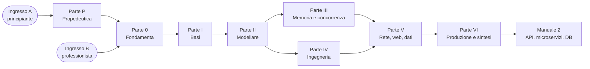
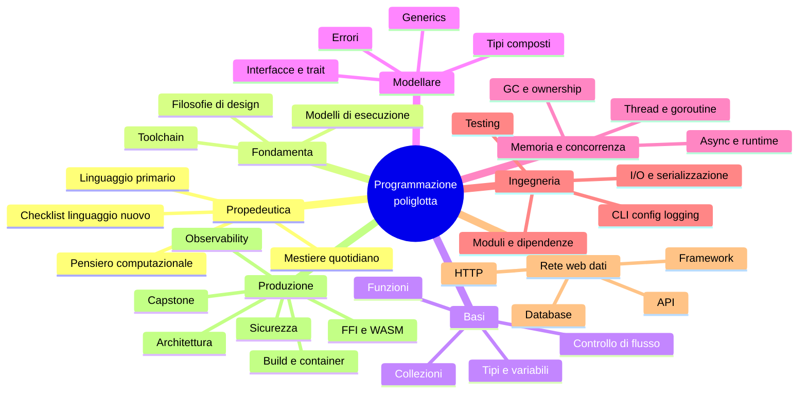

# Programmazione poliglotta: PHP, Python, Rust, Go

**Table of Contents e Roadmap del corso/manuale** — versione 0.2 (2026-10-11)

Corso comparato sui quattro linguaggi più usati per web, API e microservizi, con due ingressi: uno per chi è alle prime armi, uno per chi programma già. Ogni capitolo tratta **insieme** i quattro linguaggi; ogni lezione dura al massimo 45 minuti e si chiude con un focus su similitudini e differenze.

---

## 1. Assunzioni e perimetro

| Voce | Assunzione |
|---|---|
| Ingresso A (principiante) | Nessuna esperienza di programmazione; uso di base del computer. Parte dalla Parte P |
| Ingresso B (professionista) | Conosce almeno un linguaggio o ha un profilo tecnico (sysadmin, DevOps). Parte dalla Parte 0 |
| Lingua | Italiano; terminologia tecnica in inglese |
| Versioni baseline | PHP 8.4+, Python 3.13+, Rust edition 2024, Go 1.25+ (da riverificare all'avvio della stesura) |
| Ambiente | Linux/WSL, container (Docker/Podman), VS Code o JetBrains |
| Formato | Ingresso A: 116 lezioni da 45′ (87 ore). Ingresso B: 102 lezioni (76,5 ore) |
| Perimetro | Questo documento definisce struttura, sinossi e mappe; non contiene il testo delle lezioni |
| Seguito | Base per il manuale 2: API, microservizi e database (MySQL, PostgreSQL, Oracle, Microsoft SQL Server) |

## 2. Doppio ingresso: scrivere in uno, leggere in quattro

Il corso è poliglotta dall'inizio per entrambi gli ingressi, ma in modo asimmetrico per chi comincia: il principiante **scrive** in un linguaggio primario e **legge** gli altri, poi allarga progressivamente.

| Tappa | Ingresso A: scrive in | Ingresso A: legge | Ingresso B |
|---|---|---|---|
| Parte P — Propedeutica | Primario (da CP4) | 4 | Non prevista |
| Parte 0 — Fondamenta | Primario | 4 | Formato completo |
| Parte I — Basi | Primario | 4 | Formato completo |
| Parte II — Modellare | Primario + linguaggio di contrasto | 4 | Formato completo |
| Parti III–VI | 2–4 a scelta | 4 | Formato completo |

**Linguaggio primario.** Si sceglie in LP1.3 con una scheda decisionale. Indicazione: Python o Go per chi parte da zero; PHP per chi ha un obiettivo web immediato; Rust come primario è possibile ma ha la curva più ripida ed è consigliato come secondo linguaggio.

**Linguaggio di contrasto.** Si sceglie alla fine della Parte I, per opposizione sull'asse della tipizzazione.

| Primario | Contrasto consigliato | Che cosa mette in evidenza |
|---|---|---|
| Python | Go (o Rust) | Tipi statici, compilazione, errori come valori |
| PHP | Go | Processo long-running, tipi statici, concorrenza |
| Go | Python | Tipizzazione dinamica, eccezioni, espressività |
| Rust | Python | Runtime gestito, garbage collector, prototipazione rapida |

**Strumento di transfer.** La checklist per un linguaggio nuovo (LP4.3) riusa le righe delle matrici di capitolo come domande: come dichiara i tipi, come rappresenta l'assenza, come gestisce errori, memoria, concorrenza, moduli, test. È lo strumento che resta valido per i linguaggi futuri.

## 3. Team e uso delle discipline

L'approccio multidisciplinare non è distribuito su tutto il testo: compare dove cambia la comprensione.

| Disciplina | Dove entra | Forma |
|---|---|---|
| Programmazione (PHP, Python, Rust, Go) | Ovunque | Codice idiomatico, librerie correnti, anti-pattern |
| Pedagogia e formazione | Nel metodo, non nel testo | Struttura delle lezioni, doppio ingresso, sequenza, esercizi e verifiche |
| Statistica | Solo dove si misura | Lezioni dedicate: L05.4, L13.4, L21.3, L25.5 |
| Filosofia | Solo dove un linguaggio ha fatto una scelta di fondo | Addendum "Il perché della scelta" |

### Addendum "Il perché della scelta"

È un riquadro a fine capitolo, separato dalle lezioni e facoltativo, che spiega il modello mentale dietro le scelte di design dei linguaggi: che cosa il linguaggio rende facile, che cosa rende difficile di proposito, quale idea di errore, di proprietà o di tempo presuppone. Serve a ricordare il costrutto attraverso la sua ragione, non a decorare il capitolo.

Capitoli con addendum: **C00, C02, C06, C07, C09, C10, C11, C24**. Negli altri capitoli la scelta è tecnica o di ecosistema e non richiede un addendum.

## 4. Scheda tipo di una lezione (45′)

| Fase | Formato completo (ingresso B, e ingresso A da Parte III) | Formato "primario + lettura" (ingresso A fino a Parte II) |
|---|---|---|
| Aggancio | 5′ — richiamo e problema di partenza | 5′ — richiamo e problema di partenza |
| Concetto | 8′ — forma neutra, indipendente dal linguaggio | 10′ — forma neutra, con più esempi |
| Implementazione | 20′ — stesso esempio nei 4 linguaggi | 15′ — nel linguaggio primario, scritta dallo studente |
| Focus comparativo | 8′ — similitudini, differenze, matrice | 10′ — lettura guidata degli altri 3 |
| Consolidamento | 4′ — esercizio Rosetta e domanda di verifica | 5′ — esercizio nel primario e domanda di verifica |

Il materiale è lo stesso per i due ingressi: ogni lezione contiene le quattro implementazioni. Cambia l'uso (scrittura contro lettura) e, per l'ingresso A, si aggiungono esercizi guidati per ciascun linguaggio primario.

Ogni lezione produce tre artefatti: lo snippet Rosetta (stesso problema, 4 file), la riga della matrice comparativa, il nodo della mappa mentale.

## 5. Legenda della matrice degli approcci

| Simbolo | Significato |
|---|---|
| ● | Costrutto nativo e idiomatico |
| ◐ | Approccio alternativo assimilabile (libreria, convenzione, costrutto diverso con lo stesso scopo) |
| ○ | Assente o non idiomatico |

Le matrici sono un indice per orientarsi, non una dichiarazione di equivalenza: due celle con lo stesso simbolo possono nascondere semantiche diverse. Sono indicative per le versioni baseline e vanno riverificate in fase di stesura.

---

## 6. Table of Contents

| Cap. | Titolo | Lezioni | Ore |
|---|---|---|---|
| **Parte P** | **Propedeutica (solo ingresso A)** | **14** | **10,5** |
| CP1 | Orientamento per chi inizia | 3 | 2,25 |
| CP2 | Pensiero computazionale | 4 | 3 |
| CP3 | Il mestiere quotidiano | 4 | 3 |
| CP4 | Primo programma e checklist per un linguaggio nuovo | 3 | 2,25 |
| **Parte 0** | **Fondamenta** | **6** | **4,5** |
| C00 | Orientamento: quattro filosofie di design ◆ | 3 | 2,25 |
| C01 | Toolchain e ambiente di lavoro | 3 | 2,25 |
| **Parte I** | **Basi del linguaggio** | **16** | **12** |
| C02 | Valori, tipi e variabili ◆ | 5 | 3,75 |
| C03 | Controllo di flusso e pattern matching | 3 | 2,25 |
| C04 | Funzioni e closure | 4 | 3 |
| C05 | Collezioni e iterazione | 4 | 3 |
| **Parte II** | **Modellare e astrarre** | **14** | **10,5** |
| C06 | Tipi composti e modellazione dei dati ◆ | 3 | 2,25 |
| C07 | Oggetti, interfacce, trait e composizione ◆ | 4 | 3 |
| C08 | Generics, type system avanzato, metaprogrammazione | 3 | 2,25 |
| C09 | Gestione degli errori ◆ | 4 | 3 |
| **Parte III** | **Memoria e concorrenza** | **11** | **8,25** |
| C10 | Modelli di memoria ◆ | 5 | 3,75 |
| C11 | Concorrenza, parallelismo, async ◆ | 6 | 4,5 |
| **Parte IV** | **Ingegneria del software** | **15** | **11,25** |
| C12 | Moduli, package e dipendenze | 3 | 2,25 |
| C13 | Testing e qualità | 5 | 3,75 |
| C14 | I/O, serializzazione, tempo | 4 | 3 |
| C15 | CLI, configurazione, logging | 3 | 2,25 |
| **Parte V** | **Rete, web e dati** | **17** | **12,75** |
| C16 | Networking e HTTP | 4 | 3 |
| C17 | Web framework | 5 | 3,75 |
| C18 | API: REST, gRPC, GraphQL | 4 | 3 |
| C19 | Accesso ai database | 4 | 3 |
| **Parte VI** | **Produzione e sintesi** | **23** | **17,25** |
| C20 | Build, container, deploy | 4 | 3 |
| C21 | Observability e performance | 4 | 3 |
| C22 | Sicurezza | 3 | 2,25 |
| C23 | Interoperabilità: FFI e WebAssembly | 3 | 2,25 |
| C24 | Idiomi, pattern e architettura ◆ | 4 | 3 |
| C25 | Capstone: lo stesso microservizio in 4 linguaggi | 5 | 3,75 |
| | **Totale ingresso B (Parti 0–VI)** | **102** | **76,5** |
| | **Totale ingresso A (Parti P–VI)** | **116** | **87** |

◆ = capitolo con addendum "Il perché della scelta".

---

## 7. Roadmap

Ritmo di riferimento: 3 lezioni a settimana (2h15′) più esercizi; l'ultima settimana di ogni parte include ripasso e verifica.

| Fase | Parte | Lezioni | Settimane A | Settimane B | Milestone verificabile |
|---|---|---|---|---|---|
| FP | Propedeutica | 14 | 1–5 | — | Linguaggio primario scelto; primo programma scritto, eseguito e corretto in autonomia |
| F0 | Fondamenta | 6 | 6–7 | 1–2 | Ambiente containerizzato funzionante, "hello" con formatter e linter (A: nel primario; B: nei 4) |
| F1 | Basi del linguaggio | 16 | 8–13 | 3–8 | Kata: parser di un file di log (A: nel primario, più scelta del linguaggio di contrasto; B: Rosetta nei 4) |
| F2 | Modellare e astrarre | 14 | 14–18 | 9–13 | Libreria di dominio tipizzata con gestione errori idiomatica (A: in 2 linguaggi) |
| F3 | Memoria e concorrenza | 11 | 19–22 | 14–17 | Worker pool con cancellation e timeout, senza data race |
| F4 | Ingegneria del software | 15 | 23–27 | 18–22 | CLI testata, configurabile, con log strutturati e CI verde |
| F5 | Rete, web e dati | 17 | 28–33 | 23–28 | Servizio HTTP CRUD su PostgreSQL con contratto OpenAPI |
| F6 | Produzione e sintesi | 23 | 34–41 | 29–36 | Capstone containerizzato, osservabile, con report comparativo misurato |

### Dipendenze tra le parti

### Percorsi ridotti

| Percorso | Ingresso | Capitoli | Lezioni |
|---|---|---|---|
| Primi passi (un linguaggio scritto, quattro letti) | A | Parte P, C01, C02–C05, C06, C09 | 40 |
| Essenziale | B | C00, C02, C04, C06, C07, C09, C10, C11 | 34 |
| Backend rapido | B | Essenziale + C12, C13, C16, C17, C19, C20 | 59 |
| Completo | A / B | Tutti | 116 / 102 |

---

## 8. Mappa mentale generale

---

## 9. Capitoli

### Parte P — Propedeutica (solo ingresso A)

In questa parte i quattro linguaggi compaiono solo in lettura, fino a CP4. Non ci sono matrici degli approcci: l'obiettivo è costruire gli schemi di base prima del confronto.

#### CP1 — Orientamento per chi inizia

**Sinossi.** Che cosa fa un programma e come si presenta lo stesso programma in quattro linguaggi. Si chiude con la scelta guidata del linguaggio primario, quello in cui lo studente scriverà fino alla Parte II.

**Lezioni**
1. LP1.1 — Che cosa fa un programma: input, elaborazione, output; sorgente ed esecuzione
2. LP1.2 — Lo stesso mini-programma letto nei 4 linguaggi: che cosa si riconosce, che cosa cambia
3. LP1.3 — Scegliere il linguaggio primario: criteri e scheda decisionale

**Grafici suggeriti:** schema input → elaborazione → output; lo stesso programma su 4 colonne con le parti corrispondenti evidenziate dallo stesso colore; scheda decisionale (obiettivo, contesto di lavoro, curva di apprendimento).

**Mappa mentale.** Centro: *che cos'è un programma*. Rami: istruzioni; dati; esecuzione; linguaggi come dialetti di idee comuni. Collegamenti: CP4, C00.

#### CP2 — Pensiero computazionale

**Sinossi.** Le competenze che precedono qualsiasi linguaggio: scomporre un problema, descrivere un algoritmo, seguire a mano l'evoluzione dello stato, capire come sono rappresentati i dati.

**Lezioni**
1. LP2.1 — Problemi, algoritmi, scomposizione
2. LP2.2 — Pseudocodice e flowchart
3. LP2.3 — Stato e tracing manuale: seguire un programma con carta e penna
4. LP2.4 — Dati e rappresentazione: numeri, testo, booleani, cenni di binario

**Grafici suggeriti:** albero di scomposizione di un problema; flowchart di un algoritmo quotidiano; tabella di tracing (riga per istruzione, colonna per variabile).

**Mappa mentale.** Centro: *pensare prima di scrivere*. Rami: scomposizione; algoritmo; stato; rappresentazione. Collegamenti: C02, C03, C05.

#### CP3 — Il mestiere quotidiano

**Sinossi.** Gli strumenti e le abitudini che un junior usa ogni giorno e che i corsi di linguaggio danno per scontati: terminale, editor, lettura degli errori, debugging, versionamento, documentazione.

**Lezioni**
1. LP3.1 — Terminale, file system, editor
2. LP3.2 — Leggere un messaggio di errore e uno stack trace
3. LP3.3 — Debugging: stampa, debugger, bisezione
4. LP3.4 — Git essenziale e lettura della documentazione ufficiale

**Grafici suggeriti:** anatomia di un messaggio di errore nei 4 linguaggi; ciclo ipotesi → prova → osservazione del debugging; schema working copy → commit → remote.

**Mappa mentale.** Centro: *lavorare con il codice*. Rami: ambiente; errori; debugging; versioni; documentazione. Collegamenti: C01, C09, C13.

#### CP4 — Primo programma e checklist per un linguaggio nuovo

**Sinossi.** Lo studente scrive il primo programma completo nel linguaggio primario, poi legge lo stesso programma negli altri tre e costruisce la checklist che userà per ogni linguaggio futuro.

**Lezioni**
1. LP4.1 — Dal problema al codice: un programma guidato nel linguaggio primario
2. LP4.2 — Leggere codice altrui: lo stesso programma negli altri 3 linguaggi
3. LP4.3 — La checklist per un linguaggio nuovo

| Domanda della checklist | Capitolo che la approfondisce |
|---|---|
| Come si esegue e con quali strumenti? | C00, C01 |
| Come dichiara variabili e tipi? Come rappresenta l'assenza? | C02 |
| Come esprime scelte, cicli e funzioni? | C03, C04 |
| Quali collezioni offre? | C05 |
| Come modella i dati e il comportamento? | C06, C07 |
| Come segnala e propaga gli errori? | C09 |
| Chi gestisce la memoria? | C10 |
| Come fa più cose insieme? | C11 |
| Come organizza il codice e le dipendenze? Come si testa? | C12, C13 |

**Grafici suggeriti:** la checklist come scheda stampabile; lo stesso programma su 4 colonne annotato con le voci della checklist.

**Mappa mentale.** Centro: *il primo linguaggio e il metodo per i successivi*. Rami: scrivere; leggere; confrontare; domande ricorrenti. Collegamenti: tutti i capitoli delle Parti I–III.

---

### Parte 0 — Fondamenta

#### C00 — Orientamento: quattro filosofie di design

**Sinossi.** Presenta il metodo del corso e i quattro linguaggi come risposte diverse agli stessi problemi: PHP nato per il web e la richiesta singola, Python per la leggibilità, Rust per la sicurezza senza garbage collector, Go per la semplicità su larga scala. Introduce i modelli di esecuzione, che spiegano gran parte delle differenze incontrate nei capitoli successivi.

**Lezioni**
1. L00.1 — Come si usa il corso: lezione tipo, Rosetta, matrice, mappe mentali
2. L00.2 — Quattro filosofie di design: storia, obiettivi, compromessi dichiarati
3. L00.3 — Modelli di esecuzione: interprete e bytecode, compilazione AOT, runtime, ciclo di vita di un processo

| Aspetto | PHP | Python | Rust | Go |
|---|---|---|---|---|
| Esecuzione | Bytecode + OPcache, JIT opzionale | Bytecode su VM (CPython) | AOT nativo via LLVM | AOT nativo con runtime incluso |
| Tipizzazione | Dinamica, graduale | Dinamica, graduale | Statica, forte | Statica, forte |
| Gestione memoria | Refcount + cycle collector | Refcount + GC ciclico | Ownership, nessun GC | GC tracing concorrente |
| Ciclo di vita tipico | Per richiesta (shared-nothing) | Processo long-running | Processo long-running | Processo long-running |

**Grafici suggeriti:** timeline storica dei 4 linguaggi; diagramma "dal sorgente all'esecuzione" a 4 corsie; radar chart dei compromessi (prestazioni, curva di apprendimento, sicurezza, ecosistema, velocità di sviluppo).

**Mappa mentale.** Centro: *perché quattro linguaggi*. Rami: obiettivi di design; modello di esecuzione; tipizzazione; memoria; ambito d'uso. Collegamenti: C02, C10, C11, C24.

**Addendum — Il perché della scelta.** Ogni linguaggio è una presa di posizione. PHP: risolvere subito il problema del web, pragmatismo prima della purezza. Python: la leggibilità conta e dovrebbe esistere un modo ovvio di fare le cose. Rust: la correttezza si dimostra prima dell'esecuzione, senza pagare a runtime. Go: la semplicità è un vincolo voluto, meno funzionalità in cambio di uniformità. Domanda guida per tutto il corso: che cosa questo linguaggio rende facile, e che cosa rende difficile di proposito?

#### C01 — Toolchain e ambiente di lavoro

**Sinossi.** Costruisce un ambiente riproducibile in container per tutti e quattro i linguaggi e mostra come ciascun ecosistema risolve installazione, gestione delle versioni, dipendenze, formattazione e linting.

**Lezioni**
1. L01.1 — Installazione, gestione delle versioni, REPL e playground
2. L01.2 — Primo progetto: struttura, manifest, dependency manager
3. L01.3 — Formatter, linter, editor, devcontainer

| Strumento | PHP | Python | Rust | Go |
|---|---|---|---|---|
| Dependency manager | ◐ Composer | ◐ uv, pip | ● Cargo | ● go mod |
| Formatter ufficiale | ◐ PHP-CS-Fixer, Pint | ◐ ruff format, black | ● rustfmt | ● gofmt |
| Linter / analisi | ◐ PHPStan, Psalm | ◐ ruff, mypy, pyright | ● clippy | ● go vet, ◐ staticcheck |
| REPL | ● php -a, ◐ PsySH | ● python, ipython | ○ (playground, evcxr) | ○ (playground) |

**Grafici suggeriti:** tabella Rosetta dei comandi (init, add, build, run, test, fmt); diagramma dell'ambiente devcontainer; albero delle directory dei 4 progetti affiancati.

**Mappa mentale.** Centro: *toolchain*. Rami: versioni; dipendenze; formato del codice; analisi statica; editor. Collegamenti: C12, C13, C20.

---

### Parte I — Basi del linguaggio

#### C02 — Valori, tipi e variabili

**Sinossi.** Che cos'è un valore, che cos'è un tipo, quando avviene il controllo. Confronta tipizzazione statica e dinamica, mutabilità, rappresentazione di numeri e stringhe, e i quattro modi di esprimere l'assenza di un valore.

**Lezioni**
1. L02.1 — Variabili, binding, mutabilità, costanti, shadowing
2. L02.2 — Tipi numerici: interi, float, overflow, precisione
3. L02.3 — Stringhe e Unicode: byte, code point, UTF-8
4. L02.4 — L'assenza di valore: null, None, Option, nil e zero values
5. L02.5 — Conversioni: cast espliciti, coercion, type juggling

| Costrutto | PHP | Python | Rust | Go |
|---|---|---|---|---|
| Tipizzazione statica | ◐ type declarations a runtime, `strict_types` | ◐ type hints verificati da tool esterni | ● | ● |
| Inferenza di tipo | ◐ solo negli analyzer | ◐ solo nei type checker | ● `let` | ● `:=` |
| Immutabilità di default | ○ (`const`, `readonly`) | ○ (convenzione, `Final`) | ● `mut` esplicito | ○ (`const` solo compile-time) |
| Valore nullo | ● `null`, `?T` | ● `None`, `T \| None` | ◐ `Option<T>` | ● `nil` + zero values |
| Overflow degli interi | Promozione a float | Interi a precisione arbitraria | Panic in debug, wrap in release, `checked_*` | Wrap silenzioso |
| Stringa | Sequenza di byte (mbstring) | Sequenza di code point | UTF-8 validato (`String`, `&str`) | Byte, UTF-8 per convenzione (`rune`) |

**Grafici suggeriti:** quadrante statico/dinamico × forte/debole; layout in memoria di una stringa nei 4 linguaggi; tabella di verità delle conversioni implicite; diagramma decisionale "può essere assente?".

**Mappa mentale.** Centro: *valore e tipo*. Rami: binding e mutabilità; numeri; testo; assenza; conversione. Collegamenti: C06, C08, C09, C10.

**Addendum — Il perché della scelta.** Tipizzazione dinamica e statica esprimono due idee di fiducia: fidarsi del programmatore e scoprire l'errore eseguendo, oppure pretendere la prova prima di eseguire. Sull'assenza di valore: `null` tratta il "niente" come un valore qualsiasi (la scelta che Hoare ha poi chiamato il suo errore da un miliardo di dollari); `Option` di Rust lo rende un caso che il tipo obbliga a considerare; gli zero values di Go partono dall'idea che ogni variabile debba essere utilizzabile appena dichiarata. Sul modello di variabile: scatola che contiene un valore (Rust, Go) contro etichetta attaccata a un oggetto (Python).

#### C03 — Controllo di flusso e pattern matching

**Sinossi.** Condizionali, cicli e pattern matching, con attenzione alla distinzione tra istruzione ed espressione e al controllo di esaustività.

**Lezioni**
1. L03.1 — Condizionali: istruzioni contro espressioni
2. L03.2 — Cicli e iterazione: for, while, loop, range
3. L03.3 — Pattern matching ed esaustività

| Costrutto | PHP | Python | Rust | Go |
|---|---|---|---|---|
| Condizionale come espressione | ● `?:`, `match` | ● `x if c else y` | ● `if` è espressione | ○ |
| Cicli | `for`, `foreach`, `while`, `do-while` | `for`, `while` (+ `else`) | `loop`, `while`, `for` | solo `for` |
| Pattern matching strutturale | ◐ `match` su valori | ● `match`/`case` | ● `match`, `if let` | ◐ `switch`, type switch |
| Esaustività verificata | ◐ errore a runtime | ◐ type checker | ● a compile-time | ○ (linter) |

**Grafici suggeriti:** flowchart dello stesso algoritmo nei 4 stili; tabella dei costrutti di ciclo; albero di decisione del pattern matching.

**Mappa mentale.** Centro: *flusso*. Rami: scelta; ripetizione; destrutturazione; esaustività. Collegamenti: C05, C06, C09.

#### C04 — Funzioni e closure

**Sinossi.** La funzione come unità di astrazione: firme, passaggio degli argomenti, valori di ritorno, closure e funzioni di ordine superiore.

**Lezioni**
1. L04.1 — Firme, parametri, ritorni; passaggio per valore e per riferimento
2. L04.2 — Closure e funzioni first-class: cattura dell'ambiente
3. L04.3 — Funzioni di ordine superiore: map, filter, reduce, composizione
4. L04.4 — Scope, durata delle variabili, ricorsione

| Costrutto | PHP | Python | Rust | Go |
|---|---|---|---|---|
| Closure | ● `function() use`, `fn =>` | ● `lambda`, funzioni annidate | ● `Fn`, `FnMut`, `FnOnce` | ● func literal |
| Default e named arguments | ● | ● | ◐ builder, `Default` | ◐ functional options |
| Variadic | ● `...$args` | ● `*args`, `**kwargs` | ◐ macro, slice | ● `...T` |
| Ritorni multipli | ◐ array + destructuring | ● tuple | ● tuple | ● nativi |
| Passaggio per riferimento | ● `&$x` (oggetti per handle) | ◐ call by sharing | ● `&T`, `&mut T` | ● puntatori `*T` |

**Grafici suggeriti:** diagramma dello stack di chiamata; schema della cattura di una closure (per valore, per riferimento, per move); pipeline map/filter/reduce.

**Mappa mentale.** Centro: *funzione*. Rami: firma; argomenti; closure; ordine superiore; scope. Collegamenti: C05, C08, C10, C11.

#### C05 — Collezioni e iterazione

**Sinossi.** Sequenze, mappe e insiemi, protocollo di iterazione, valutazione lazy e criteri di scelta basati su complessità e misure.

**Lezioni**
1. L05.1 — Sequenze: array, list, Vec, slice
2. L05.2 — Mappe e set
3. L05.3 — Iteratori, generatori, lazy evaluation
4. L05.4 — Complessità e scelta della struttura dati

| Costrutto | PHP | Python | Rust | Go |
|---|---|---|---|---|
| Array dinamico | ◐ `array` (hash map ordinata) | ● `list` | ● `Vec<T>` | ● slice |
| Mappa | ● `array` | ● `dict` | ● `HashMap`, `BTreeMap` | ● `map` |
| Set | ◐ chiavi di array, `Ds\Set` | ● `set` | ● `HashSet` | ◐ `map[T]struct{}` |
| Generatori / iteratori lazy | ● `yield` | ● `yield`, generator expression | ● trait `Iterator` | ◐ `iter.Seq`, range-over-func |
| Comprehension | ○ (`array_map`) | ● | ◐ catene di iteratori + `collect` | ○ (cicli, package `slices`) |

**Grafici suggeriti:** layout di slice (pointer, len, cap) e di Vec; schema di una hash table; grafico Big-O; boxplot di benchmark per operazione.

**Mappa mentale.** Centro: *collezione*. Rami: sequenze; associazioni; insiemi; iterazione; costo. Collegamenti: C04, C10, C13, C21.

---

### Parte II — Modellare e astrarre

#### C06 — Tipi composti e modellazione dei dati

**Sinossi.** Come rappresentare i dati del dominio: record, enum, sum types, immutabilità. Introduce il principio "rendere irrappresentabili gli stati illegali".

**Lezioni**
1. L06.1 — Struct, class e record
2. L06.2 — Enum e sum types
3. L06.3 — Immutabilità e value objects

| Costrutto | PHP | Python | Rust | Go |
|---|---|---|---|---|
| Record / struct | ◐ class con constructor promotion | ● `dataclass`, `NamedTuple` | ● `struct` | ● `struct` |
| Enum | ● pure e backed | ● `enum.Enum` | ● con dati associati | ◐ `const` + `iota` |
| Sum type con dati | ◐ interface + classi, union types | ◐ `Union` + `match` | ● `enum` | ◐ interface + type switch |
| Immutabilità | ● `readonly` | ◐ `frozen=True` | ● default | ○ (campi non esportati) |

**Grafici suggeriti:** class diagram dello stesso modello nei 4 linguaggi; tabella prodotto contro somma di tipi; state diagram di un ordine modellato con enum.

**Mappa mentale.** Centro: *modello dei dati*. Rami: prodotto; somma; identità contro valore; immutabilità. Collegamenti: C02, C07, C09, C14, C19.

**Addendum — Il perché della scelta.** Rust persegue l'idea di rendere irrappresentabili gli stati illegali: se il tipo non può esprimere l'errore, l'errore non può esistere. Go rinuncia ai sum types di proposito, preferendo un linguaggio piccolo a uno espressivo. PHP e Python hanno aggiunto enum, `readonly` e dataclass nel tempo: pragmatismo con correzioni successive, e codice vecchio e nuovo che convivono.

#### C07 — Oggetti, interfacce, trait e composizione

**Sinossi.** Quattro risposte al problema del riuso e del polimorfismo: ereditarietà classica, duck typing, trait, interfacce strutturali ed embedding.

**Lezioni**
1. L07.1 — Metodi, incapsulamento, visibilità
2. L07.2 — Ereditarietà contro composizione
3. L07.3 — Interfacce, trait, protocol: tipizzazione nominale e strutturale
4. L07.4 — Polimorfismo: dispatch statico e dinamico

| Costrutto | PHP | Python | Rust | Go |
|---|---|---|---|---|
| Classi ed ereditarietà | ● singola | ● multipla (MRO) | ○ | ○ (embedding) |
| Interfaccia | ● nominale | ◐ ABC nominale, `Protocol` strutturale | ● trait, `impl` esplicito | ● strutturale implicita |
| Riuso orizzontale | ● `trait` | ● mixin | ◐ metodi di default nei trait | ◐ embedding |
| Visibilità | ● public / protected / private | ◐ convenzione `_` | ● `pub`, per modulo | ● maiuscola, per package |
| Dispatch statico | ○ | ○ | ● generics | ◐ generics |

**Grafici suggeriti:** class diagram ereditarietà contro composizione; schema di vtable e fat pointer; matrice nominale/strutturale × statico/dinamico. Nota didattica: "trait" in PHP e in Rust indicano cose diverse, dedicare un riquadro.

**Mappa mentale.** Centro: *astrazione del comportamento*. Rami: incapsulamento; riuso; contratto; dispatch. Collegamenti: C06, C08, C13, C24.

**Addendum — Il perché della scelta.** Tipizzazione nominale: una cosa è un X perché lo dichiara (PHP, trait di Rust). Tipizzazione strutturale: è un X perché si comporta da X (interfacce di Go, `Protocol` e duck typing in Python). Sono due idee diverse di identità: essenza dichiarata contro comportamento osservato. Sull'ereditarietà: è una tassonomia, e le tassonomie invecchiano male quando il dominio cambia; Rust e Go la escludono deliberatamente a favore della composizione.

#### C08 — Generics, type system avanzato, metaprogrammazione

**Sinossi.** Astrazione sui tipi e codice che genera o ispeziona codice: generics, tipi unione, gradual typing, reflection, attributi, decorator, macro.

**Lezioni**
1. L08.1 — Generics e vincoli
2. L08.2 — Gradual typing: type hints, union, intersection, type checker
3. L08.3 — Metaprogrammazione: reflection, attributi, decorator, macro, code generation

| Costrutto | PHP | Python | Rust | Go |
|---|---|---|---|---|
| Generics | ◐ `@template` + PHPStan/Psalm | ◐ sintassi nativa, verifica esterna | ● monomorphization, trait bounds | ● type parameters |
| Union types | ● | ● | ◐ `enum` | ◐ type set nei constraint |
| Reflection a runtime | ● Reflection API | ● introspezione | ○ | ● `reflect` |
| Annotazioni / generazione | ● attributes | ● decorator | ● macro `derive` e procedurali | ◐ struct tags, `go generate` |

**Grafici suggeriti:** monomorphization contro type erasure; pipeline di un type checker esterno; momento di esecuzione (compile-time, load-time, runtime) dei 4 meccanismi di metaprogrammazione.

**Mappa mentale.** Centro: *astrazione sui tipi*. Rami: parametri di tipo; vincoli; tipi graduali; codice su codice. Collegamenti: C02, C07, C13, C14.

#### C09 — Gestione degli errori

**Sinossi.** Due scuole: eccezioni (PHP, Python) ed errori come valori (Rust, Go). Propagazione, arricchimento del contesto, rilascio deterministico delle risorse, errori non recuperabili.

**Lezioni**
1. L09.1 — Eccezioni contro errori come valori
2. L09.2 — Propagazione, wrapping e gerarchie di errori
3. L09.3 — Rilascio delle risorse: finally, with, defer, RAII
4. L09.4 — Panic, errori fatali e progettazione per il fallimento

| Costrutto | PHP | Python | Rust | Go |
|---|---|---|---|---|
| Eccezioni | ● `try/catch` | ● `try/except` | ○ | ○ |
| Errori come valori | ◐ non idiomatico | ◐ non idiomatico | ● `Result<T, E>` | ● `(T, error)` |
| Propagazione | Automatica (unwinding) | Automatica (unwinding) | Esplicita con `?` | Esplicita con `if err != nil` |
| Wrapping del contesto | ● `previous` | ● `raise ... from` | ◐ `thiserror`, `anyhow` | ● `%w`, `errors.Is/As` |
| Cleanup deterministico | ◐ `finally` | ● `with` | ● `Drop` (RAII) | ● `defer` |
| Non recuperabile | `Error`, fatal | `BaseException` | `panic!` | `panic` / `recover` |

**Grafici suggeriti:** sequence diagram della propagazione nei due modelli; albero delle gerarchie di errore; flowchart "recuperare, propagare o terminare".

**Mappa mentale.** Centro: *fallimento*. Rami: rappresentazione; propagazione; contesto; cleanup; irrecuperabile. Collegamenti: C06, C10, C11, C17, C21.

**Addendum — Il perché della scelta.** Le eccezioni trattano l'errore come evento eccezionale, da tenere fuori dal percorso principale: il codice del caso felice resta pulito, ma dalla firma non si vede che cosa può fallire. Gli errori come valori lo trattano come esito ordinario: il fallimento è visibile e va gestito sul posto, al prezzo della verbosità. Go considera quella verbosità una virtù; Rust la riduce con `?` ma lascia al compilatore il compito di impedire che un errore venga ignorato. Dietro c'è una differenza di atteggiamento: ottimismo sul percorso normale contro fallibilismo dichiarato.

---

### Parte III — Memoria e concorrenza

#### C10 — Modelli di memoria

**Sinossi.** Il capitolo dove i quattro linguaggi divergono di più: garbage collection in tre varianti e ownership in Rust. Semantica di copia, move, riferimenti e puntatori.

**Lezioni**
1. L10.1 — Stack, heap, valori e riferimenti
2. L10.2 — Garbage collection: reference counting e tracing
3. L10.3 — Ownership e borrowing
4. L10.4 — Lifetimes, smart pointers e i loro equivalenti
5. L10.5 — Puntatori ed escape analysis in Go; reference e copy-on-write in PHP; mutabilità condivisa in Python

| Costrutto | PHP | Python | Rust | Go |
|---|---|---|---|---|
| Garbage collector | ● refcount + cycle collector | ● refcount + GC generazionale | ○ (`Rc`/`Arc` opt-in) | ● tracing concorrente |
| Ownership e borrowing | ○ | ○ | ● | ○ (escape analysis) |
| Puntatori espliciti | ◐ reference `&` | ○ | ● reference, raw pointer | ● senza aritmetica |
| Semantica di assegnazione | Array per valore (CoW), oggetti per handle | Sempre riferimento | Move di default, `Copy`/`Clone` | Copia per valore |
| Weak reference | ● `WeakReference`, `WeakMap` | ● `weakref` | ● `Weak<T>` | ● package `weak` |

**Grafici suggeriti:** diagramma stack/heap per lo stesso programma nei 4 linguaggi; animazione a fotogrammi di un move e di un borrow; ciclo di reference counting con ciclo orfano; timeline di una GC pause.

**Mappa mentale.** Centro: *chi possiede la memoria*. Rami: allocazione; rilascio automatico; ownership; aliasing; costo. Collegamenti: C02, C04, C09, C11, C21, C23.

**Addendum — Il perché della scelta.** La domanda è chi risponde della memoria. Con il garbage collector la responsabilità è delegata al runtime: comodità subito, costo durante l'esecuzione. Con l'ownership è dichiarata nel codice e verificata dal compilatore: costo nell'apprendimento, nessuno a runtime. Il modello di Rust ricalca la proprietà e il prestito: un solo proprietario, molti lettori oppure un solo scrittore. Go sceglie che il programmatore non debba pensarci, e lascia decidere all'escape analysis.

#### C11 — Concorrenza, parallelismo, async

**Sinossi.** Dal modello shared-nothing per richiesta di PHP alle goroutine di Go, passando per GIL e asyncio in Python e per le garanzie a compile-time di Rust. Pattern di coordinamento, cancellation e backpressure.

**Lezioni**
1. L11.1 — Concorrenza contro parallelismo; modelli di esecuzione a confronto
2. L11.2 — Thread e stato condiviso: mutex, atomics, GIL
3. L11.3 — Message passing: channel, queue, CSP
4. L11.4 — Async/await ed event loop
5. L11.5 — I runtime: scheduler di Go, tokio, asyncio, Fibers
6. L11.6 — Pattern: worker pool, cancellation, timeout, backpressure, structured concurrency

| Costrutto | PHP | Python | Rust | Go |
|---|---|---|---|---|
| Thread di sistema | ◐ ext-parallel; modello a processi | ● `threading` (GIL; build free-threaded) | ● `std::thread` | ◐ goroutine M:N |
| Coroutine / green thread | ● Fibers | ● coroutine | ◐ task su runtime esterno | ● goroutine |
| Keyword `async`/`await` | ○ (AMPHP, ReactPHP, Swoole) | ● | ● (runtime esterno) | ○ (non necessaria) |
| Channel | ◐ librerie | ◐ `queue`, `asyncio.Queue` | ● `mpsc`, tokio, crossbeam | ● `chan`, `select` |
| Prevenzione data race | ○ (shared-nothing) | ○ | ● `Send`/`Sync` a compile-time | ◐ race detector a runtime |
| Cancellation | ◐ librerie | ● `cancel`, `timeout` | ● drop del future, token | ● `context.Context` |
| Structured concurrency | ◐ | ● `TaskGroup` | ● `JoinSet`, scope | ● `errgroup` |

**Grafici suggeriti:** timeline concorrenza contro parallelismo; schema M:N dello scheduler; event loop; sequence diagram di un worker pool; state diagram di un task con cancellation.

**Mappa mentale.** Centro: *fare più cose*. Rami: unità di esecuzione; stato condiviso; messaggi; async; coordinamento. Collegamenti: C09, C10, C16, C19, C21.

**Addendum — Il perché della scelta.** Quattro risposte allo stesso pericolo, lo stato condiviso. PHP lo evita isolando ogni richiesta. Python lo ha contenuto con il GIL, un compromesso storico che semplifica interprete ed estensioni C a spese del parallelismo. Go inverte l'abitudine: condividere dati scambiandosi messaggi, invece di scambiarsi messaggi tramite dati condivisi. Rust trasforma gli errori di concorrenza in errori di tipo, rilevati prima dell'esecuzione. Sull'async: Python e Rust distinguono le funzioni asincrone nella firma; Go rifiuta la distinzione e rende economico bloccare.

---

### Parte IV — Ingegneria del software

#### C12 — Moduli, package e dipendenze

**Sinossi.** Organizzazione del codice in unità riusabili, regole di visibilità, risoluzione delle dipendenze, lockfile e riproducibilità.

**Lezioni**
1. L12.1 — Moduli, namespace e visibilità
2. L12.2 — Dipendenze: semver, risoluzione, lockfile, supply chain
3. L12.3 — Layout di progetto, workspace e monorepo

| Costrutto | PHP | Python | Rust | Go |
|---|---|---|---|---|
| Unità di modularità | `namespace` + autoload PSR-4 | Modulo = file, package = directory | `mod`, crate | Package = directory, module = `go.mod` |
| Registry | Packagist | PyPI | crates.io | Decentralizzato (VCS + proxy) |
| Lockfile | ● `composer.lock` | ◐ dipende dal tool (`uv.lock`) | ● `Cargo.lock` | ◐ `go.sum` + MVS |
| Workspace | ◐ path repositories | ● uv workspaces | ● Cargo workspaces | ● `go.work` |

**Grafici suggeriti:** grafo delle dipendenze di un progetto; confronto degli algoritmi di risoluzione (SAT contro Minimal Version Selection); alberi di directory idiomatici.

**Mappa mentale.** Centro: *organizzare il codice*. Rami: confini; visibilità; versioni; riproducibilità. Collegamenti: C01, C13, C20, C22.

#### C13 — Testing e qualità

**Sinossi.** Test come specifica eseguibile: unit, integration, property-based, fuzzing, benchmark letti con criterio statistico, analisi statica in CI.

**Lezioni**
1. L13.1 — Unit test: struttura, asserzioni, fixture
2. L13.2 — Test double e integration test con Testcontainers
3. L13.3 — Property-based testing e fuzzing
4. L13.4 — Benchmark e statistica delle misure
5. L13.5 — Analisi statica, coverage, CI

| Strumento | PHP | Python | Rust | Go |
|---|---|---|---|---|
| Framework di test | ◐ PHPUnit, Pest | ● `unittest`, ◐ pytest | ● `cargo test` | ● `go test` |
| Property-based | ◐ Eris | ◐ Hypothesis | ◐ proptest, quickcheck | ◐ `testing/quick`, rapid |
| Fuzzing | ◐ php-fuzzer | ◐ Atheris | ◐ cargo-fuzz | ● nativo |
| Benchmark | ◐ PHPBench | ◐ pytest-benchmark | ◐ criterion | ● `testing.B` |
| Analisi statica | ◐ PHPStan, Psalm | ◐ mypy, pyright, ruff | ● compilatore, clippy | ● `go vet`, ◐ staticcheck |

**Grafici suggeriti:** piramide dei test; ciclo red-green-refactor; distribuzione dei tempi di un benchmark con intervalli di confidenza; pipeline CI.

**Mappa mentale.** Centro: *fiducia nel codice*. Rami: esempi; proprietà; misure; analisi; automazione. Collegamenti: C08, C09, C12, C20, C21.

#### C14 — I/O, serializzazione, tempo

**Sinossi.** File e stream, formati di scambio, validazione dei dati in ingresso, gestione corretta di date e fusi orari.

**Lezioni**
1. L14.1 — File, stream e buffering
2. L14.2 — JSON e formati di scambio (YAML, TOML, binari)
3. L14.3 — Validazione e schema: dal dato grezzo al tipo
4. L14.4 — Tempo, date, timezone

| Costrutto | PHP | Python | Rust | Go |
|---|---|---|---|---|
| Astrazione di stream | ● stream wrappers | ● file objects, `io` | ● trait `Read`/`Write` | ● `io.Reader`/`io.Writer` |
| JSON | ● `json_encode/decode` | ● `json` | ◐ serde_json | ● `encoding/json` |
| Validazione tipizzata | ◐ Symfony Serializer/Validator, Valinor | ◐ Pydantic | ◐ serde + validator/garde | ◐ struct tags + validator |
| Date e timezone | ● `DateTimeImmutable` | ● `datetime`, `zoneinfo` | ◐ chrono, jiff, time | ● `time` |

**Grafici suggeriti:** pipeline byte → testo → struttura → tipo validato; confronto di dimensione e velocità dei formati; linea del tempo UTC/locale con cambio dell'ora legale.

**Mappa mentale.** Centro: *il confine del programma*. Rami: stream; formati; validazione; tempo. Collegamenti: C06, C08, C16, C18, C19.

#### C15 — CLI, configurazione, logging

**Sinossi.** Costruire uno strumento a riga di comando ben educato: argomenti, exit code, configurazione 12-factor, log strutturati.

**Lezioni**
1. L15.1 — CLI: argomenti, sottocomandi, exit code, stdin/stdout
2. L15.2 — Configurazione: variabili d'ambiente, file, secret
3. L15.3 — Logging strutturato e livelli

| Strumento | PHP | Python | Rust | Go |
|---|---|---|---|---|
| CLI | ◐ symfony/console | ● `argparse`, ◐ click, typer | ◐ clap | ● `flag`, ◐ cobra |
| Configurazione | ◐ symfony/dotenv, phpdotenv | ◐ pydantic-settings | ◐ figment, config | ◐ koanf, viper, envconfig |
| Logging strutturato | ◐ Monolog (PSR-3) | ● `logging`, ◐ structlog | ◐ tracing, log | ● `log/slog` |

**Grafici suggeriti:** anatomia di un comando; ordine di precedenza delle sorgenti di configurazione; esempio di log JSON annotato.

**Mappa mentale.** Centro: *strumento operabile*. Rami: interfaccia; configurazione; log. Collegamenti: C14, C20, C21, C22.

---

### Parte V — Rete, web e dati

#### C16 — Networking e HTTP

**Sinossi.** Dal socket TCP al server HTTP. Confronta i modelli di serving (PHP-FPM e worker mode, WSGI/ASGI, hyper, net/http) e l'astrazione di middleware.

**Lezioni**
1. L16.1 — Socket e TCP
2. L16.2 — HTTP client: timeout, retry, connection pooling
3. L16.3 — Modelli di server HTTP
4. L16.4 — Middleware e ciclo di vita della richiesta

| Costrutto | PHP | Python | Rust | Go |
|---|---|---|---|---|
| HTTP client | ◐ Guzzle, Symfony HttpClient | ◐ httpx, requests | ◐ reqwest | ● `net/http` |
| HTTP server di produzione | ◐ PHP-FPM, FrankenPHP, RoadRunner | ◐ uvicorn, gunicorn, granian | ◐ hyper | ● `net/http` |
| Interfaccia standard | PSR-7, PSR-15 | WSGI, ASGI | `tower::Service` | `http.Handler` |
| Processo long-running | ◐ worker mode | ● | ● | ● |

**Grafici suggeriti:** sequence diagram di una richiesta nei 4 modelli di serving; modello a cipolla dei middleware; diagramma del connection pool.

**Mappa mentale.** Centro: *richiesta e risposta*. Rami: trasporto; client; server; middleware. Collegamenti: C11, C14, C17, C18, C21.

**Ponte al manuale 2:** resilienza tra servizi (circuit breaker, retry budget).

#### C17 — Web framework

**Sinossi.** I framework di riferimento e i concetti che condividono: routing, dependency injection, validazione, autenticazione, rendering.

**Lezioni**
1. L17.1 — Routing e handler
2. L17.2 — Dependency injection e struttura dell'applicazione
3. L17.3 — Validazione, serializzazione, risposte di errore
4. L17.4 — Autenticazione e autorizzazione: sessioni, JWT, OAuth2/OIDC
5. L17.5 — Template e rendering lato server

| Aspetto | PHP | Python | Rust | Go |
|---|---|---|---|---|
| Framework di riferimento | Symfony, Laravel, Slim | FastAPI, Django, Flask, Litestar | Axum, Actix Web | stdlib, Chi, Gin, Echo |
| Dependency injection | ● container con autowiring | ◐ `Depends` | ◐ extractor, `State` | ◐ costruttori espliciti |
| Template engine | ◐ Twig, Blade | ◐ Jinja2 | ◐ Askama, Tera | ● `html/template` |
| Stile | Full-stack o micro | Full-stack o micro | Micro, composizione | Micro, stdlib-first |

**Grafici suggeriti:** tabella comparativa dei framework; grafo delle dipendenze risolto dal container; sequence diagram del flusso OIDC.

**Mappa mentale.** Centro: *applicazione web*. Rami: routing; composizione; validazione; identità; rendering. Collegamenti: C07, C09, C14, C16, C18, C22.

#### C18 — API: REST, gRPC, GraphQL

**Sinossi.** Progettazione di contratti e loro implementazione nei quattro linguaggi. Capitolo introduttivo che prepara il manuale 2.

**Lezioni**
1. L18.1 — REST e OpenAPI: design contract-first
2. L18.2 — gRPC e Protocol Buffers
3. L18.3 — GraphQL: panoramica e casi d'uso
4. L18.4 — Versioning, idempotenza, paginazione, error model

| Tecnologia | PHP | Python | Rust | Go |
|---|---|---|---|---|
| OpenAPI | ◐ API Platform, swagger-php | ● FastAPI (generazione integrata) | ◐ utoipa, aide | ◐ oapi-codegen, huma |
| gRPC | ◐ client via estensione, server via RoadRunner | ◐ grpcio | ◐ tonic | ◐ grpc-go, connect |
| GraphQL | ◐ webonyx, Lighthouse | ◐ Strawberry | ◐ async-graphql | ◐ gqlgen |

**Grafici suggeriti:** matrice decisionale REST / gRPC / GraphQL; flusso contract-first contro code-first; sequence diagram di una richiesta idempotente con retry.

**Mappa mentale.** Centro: *contratto*. Rami: stile; schema; evoluzione; errori. Collegamenti: C14, C16, C17, C19.

**Ponte al manuale 2:** API gateway, messaging asincrono, saga, service discovery.

#### C19 — Accesso ai database

**Sinossi.** Driver, connection pool, query sicure, ORM contro SQL-first, transazioni e migration. Esempi su PostgreSQL e MySQL; gli altri motori sono rimandati al manuale 2.

**Lezioni**
1. L19.1 — Driver e connection pool
2. L19.2 — Query, prepared statement, SQL injection
3. L19.3 — ORM, query builder, SQL-first
4. L19.4 — Transazioni e migration

| Aspetto | PHP | Python | Rust | Go |
|---|---|---|---|---|
| Accesso di base | ● PDO | ◐ psycopg, asyncpg | ◐ sqlx | ● `database/sql`, ◐ pgx |
| Connection pool | ◐ per richiesta; pooler esterno | ◐ SQLAlchemy, psycopg_pool | ◐ pool di sqlx, deadpool | ● integrato |
| ORM | ◐ Doctrine, Eloquent | ◐ SQLAlchemy, Django ORM | ◐ Diesel, SeaORM | ◐ GORM, ent |
| SQL-first tipizzato | ◐ DBAL | ◐ SQLAlchemy Core | ◐ sqlx (verifica a compile-time) | ◐ sqlc |
| Migration | ◐ Doctrine Migrations, Phinx | ◐ Alembic | ◐ sqlx migrate, refinery | ◐ goose, golang-migrate, Atlas |

**Grafici suggeriti:** ciclo di vita di una connessione nel pool; spettro raw SQL → query builder → ORM; sequence diagram di una transazione con rollback.

**Mappa mentale.** Centro: *persistenza*. Rami: connessione; query; mapping; transazione; evoluzione dello schema. Collegamenti: C06, C09, C11, C14, C22.

**Ponte al manuale 2:** differenze tra MySQL, PostgreSQL, Oracle, SQL Server; isolamento, locking, piani di esecuzione, replica.

---

### Parte VI — Produzione e sintesi

#### C20 — Build, container, deploy

**Sinossi.** Dall'artefatto all'immagine al cluster: binari statici contro runtime interpretati, multi-stage build, graceful shutdown, pipeline CI/CD.

**Lezioni**
1. L20.1 — Build e artefatti
2. L20.2 — Immagini container multi-stage
3. L20.3 — Signal, graceful shutdown, health probe
4. L20.4 — Pipeline CI/CD

| Aspetto | PHP | Python | Rust | Go |
|---|---|---|---|---|
| Artefatto | Sorgente + runtime (◐ PHAR, binario FrankenPHP) | Wheel + interprete | ● binario statico | ● binario statico |
| Cross-compilation | n/a | n/a (wheel per piattaforma) | ● target, `cross` | ● `GOOS`/`GOARCH` |
| Immagine base tipica | php-fpm, frankenphp | python-slim | distroless, scratch | distroless, scratch |
| Gestione dei signal | ◐ pcntl | ● `signal` | ◐ `tokio::signal` | ● `os/signal`, `Shutdown` |

**Grafici suggeriti:** diagramma di una multi-stage build; bar chart delle dimensioni delle immagini; sequence diagram di SIGTERM con draining; pipeline CI/CD.

**Mappa mentale.** Centro: *dal codice al cluster*. Rami: artefatto; immagine; ciclo di vita; automazione. Collegamenti: C01, C12, C13, C15, C21, C22.

#### C21 — Observability e performance

**Sinossi.** Capire un sistema in esecuzione: log, metriche e trace con OpenTelemetry, profiling, lettura statistica delle prestazioni, ottimizzazione guidata dai dati.

**Lezioni**
1. L21.1 — OpenTelemetry: log, metrics, trace
2. L21.2 — Profiling CPU e memoria
3. L21.3 — Statistica delle prestazioni: percentili, distribuzioni, load test
4. L21.4 — Ottimizzazione: dove intervenire e quando fermarsi

| Strumento | PHP | Python | Rust | Go |
|---|---|---|---|---|
| OpenTelemetry SDK | ◐ | ◐ | ◐ | ◐ |
| Profiler | ◐ Xdebug, SPX, Excimer | ● `cProfile`, ◐ py-spy, scalene | ◐ perf, cargo-flamegraph | ● `pprof`, `trace` |
| Auto-instrumentation | ◐ estensione | ● agent | ○ manuale | ◐ eBPF |

**Grafici suggeriti:** waterfall di un trace distribuito; flame graph annotato; istogramma di latenza con p50/p95/p99; curva throughput/latenza al crescere del carico.

**Mappa mentale.** Centro: *vedere il sistema*. Rami: segnali; profiling; misura; ottimizzazione. Collegamenti: C05, C10, C11, C13, C16.

#### C22 — Sicurezza

**Sinossi.** Classi di vulnerabilità tipiche di ciascun linguaggio, sicurezza della supply chain, crittografia e gestione dei secret, con riferimento ai requisiti di SBOM e gestione delle vulnerabilità (CRA, NIS2).

**Lezioni**
1. L22.1 — Classi di vulnerabilità per linguaggio
2. L22.2 — Supply chain: audit, SBOM, firma
3. L22.3 — Crittografia e secret management

| Aspetto | PHP | Python | Rust | Go |
|---|---|---|---|---|
| Memory safety | ● runtime gestito | ● runtime gestito | ● a compile-time (`unsafe` opt-out) | ● runtime gestito (`unsafe`, data race) |
| Rischi tipici | Injection, `unserialize`, type juggling, file inclusion | `pickle`, `eval`, SSTI, dependency confusion | `unsafe`, panic come DoS | Data race, nil dereference, goroutine leak |
| Audit dipendenze | ● `composer audit` | ◐ pip-audit | ◐ cargo-audit, cargo-deny | ● govulncheck |
| Crittografia | ● sodium, openssl | ● `hashlib`, ◐ cryptography | ◐ RustCrypto, ring, rustls | ● `crypto/*` |

**Grafici suggeriti:** matrice vulnerabilità × linguaggio; flusso della supply chain con punti di controllo; threat model di un servizio HTTP.

**Mappa mentale.** Centro: *fiducia e minaccia*. Rami: input; memoria; dipendenze; segreti. Collegamenti: C12, C14, C17, C19, C20.

#### C23 — Interoperabilità: FFI e WebAssembly

**Sinossi.** Far collaborare i linguaggi: chiamare C, estendere Python e PHP con Rust, compilare verso WebAssembly.

**Lezioni**
1. L23.1 — FFI e ABI C
2. L23.2 — Rust come estensione di Python e PHP
3. L23.3 — WebAssembly e WASI

| Aspetto | PHP | Python | Rust | Go |
|---|---|---|---|---|
| Chiamare C | ● estensione FFI | ● `ctypes`, ◐ cffi | ● `extern "C"`, bindgen | ● cgo |
| Essere chiamato da altri | ○ | ◐ embedding | ● `cdylib`, cbindgen | ◐ `c-shared` |
| Estensioni in Rust | ◐ ext-php-rs | ◐ PyO3, maturin | n/a | ○ |
| Target WebAssembly | ◐ php-wasm | ◐ Pyodide | ● | ● `wasip1`, ◐ TinyGo |

**Grafici suggeriti:** diagramma del confine FFI con ownership della memoria; architettura di un modulo PyO3; schema host/guest di WASM.

**Mappa mentale.** Centro: *confini tra linguaggi*. Rami: ABI; estensioni; WASM. Collegamenti: C10, C20, C22, C24.

#### C24 — Idiomi, pattern e architettura

**Sinossi.** Scrivere codice che un madrelingua riconosce come naturale, rileggere i pattern classici alla luce dei quattro linguaggi, strutturare un servizio, scegliere il linguaggio con criteri espliciti.

**Lezioni**
1. L24.1 — Idiomi: Pythonic, idiomatic Go, Rust idiomatico, PHP moderno
2. L24.2 — Design pattern riletti nei 4 linguaggi
3. L24.3 — Architettura esagonale e confini del dominio
4. L24.4 — Scegliere il linguaggio: criteri decisionali

| Pattern | PHP | Python | Rust | Go |
|---|---|---|---|---|
| Strategy | ● interface | ● funzione o Protocol | ● trait o closure | ● interface o func |
| Builder | ◐ named arguments | ◐ keyword arguments | ● idiomatico | ◐ functional options |
| Singleton | ◐ servizio nel container | ◐ modulo | ◐ `OnceLock` | ◐ `sync.Once` |
| Iterator | ● `Iterator`, generator | ● protocollo nativo | ● trait `Iterator` | ● `iter.Seq` |

**Grafici suggeriti:** diagramma esagonale con port e adapter; tabella pattern × linguaggio; decision matrix pesata per la scelta del linguaggio.

**Mappa mentale.** Centro: *giudizio progettuale*. Rami: idiomi; pattern; architettura; scelta. Collegamenti: C00, C07, C09, C17, C25.

**Addendum — Il perché della scelta.** Un idioma è cultura di comunità prima che tecnica: lo Zen of Python, i Go proverbs, le PSR di PHP, la fiducia di Rust nel compilatore. Molti design pattern sono il segno di qualcosa che manca al linguaggio: dove il costrutto è nativo, il pattern scompare. Nessun linguaggio vince fuori da un contesto, e la scelta è un giudizio su vincoli, persone e tempo oltre che su prestazioni.

#### C25 — Capstone: lo stesso microservizio in 4 linguaggi

**Sinossi.** Un unico servizio (API REST con persistenza su PostgreSQL, autenticazione, osservabilità) implementato quattro volte dallo stesso contratto OpenAPI. Le lezioni procedono per strato, non per linguaggio, e si chiudono con un confronto misurato.

**Lezioni**
1. L25.1 — Specifica e contratto OpenAPI
2. L25.2 — Dominio e persistenza
3. L25.3 — Strato HTTP e test
4. L25.4 — Container, configurazione, observability
5. L25.5 — Confronto misurato e retrospettiva

| Metrica da raccogliere | Come |
|---|---|
| Righe di codice e numero di dipendenze | Conteggio automatico |
| Tempo di build e dimensione dell'immagine | CI |
| Cold start e memoria a riposo | Misura in container |
| Latenza p50/p95/p99 e throughput | Load test identico (k6) |
| Tempo di sviluppo e difetti trovati | Diario di progetto |

**Grafici suggeriti:** architettura del servizio; tabella finale di confronto; boxplot delle latenze; radar chart riassuntivo.

**Mappa mentale.** Centro: *un servizio, quattro implementazioni*. Rami: contratto; dominio; trasporto; operatività; misura. Collegamenti: tutti, in particolare C17–C21.

**Ponte al manuale 2:** il capstone diventa il servizio di partenza da scomporre in microservizi.

---

## 10. Appendici suggerite

| Appendice | Contenuto |
|---|---|
| A — Cheat sheet Rosetta | Stessi 50 frammenti nei 4 linguaggi |
| B — Glossario comparato | Termini e falsi amici (trait, interface, module, package, slice, array) |
| C — Tabella delle librerie equivalenti | Per ambito: HTTP, DB, test, log, CLI, config |
| D — Matrice completa degli approcci | Unione delle matrici di capitolo |
| E — Rubriche di valutazione | Criteri per esercizi e capstone |
| F — Indice dei grafici | Elenco dei diagrammi da produrre, per capitolo |
| G — Checklist per un linguaggio nuovo | Scheda stampabile di LP4.3 |
| H — Esercizi guidati per linguaggio primario | Quattro serie parallele per le Parti P–II (ingresso A) |

## 11. Ponte verso il manuale 2 (API, microservizi, database)

| Tema del manuale 2 | Capitoli propedeutici |
|---|---|
| Progettazione e governance di API | C14, C17, C18 |
| Comunicazione tra servizi, messaging, resilienza | C11, C16, C18 |
| Database: MySQL, PostgreSQL, Oracle, SQL Server | C06, C19 |
| Transazioni distribuite, consistenza, saga | C09, C11, C19 |
| Deploy, scaling e operatività su Kubernetes | C20, C21 |
| Sicurezza e compliance dei servizi | C17, C22 |

## 12. Prossimi passi di stesura

1. Validare assunzioni, numero di lezioni e ordine dei capitoli
2. Riverificare versioni e librerie indicate
3. Scrivere due capitoli pilota per fissare i template: CP4 (ingresso A) e C09 (ingresso B, con addendum)
4. Produrre il set di snippet Rosetta e la matrice completa
5. Stendere le parti in ordine di roadmap
